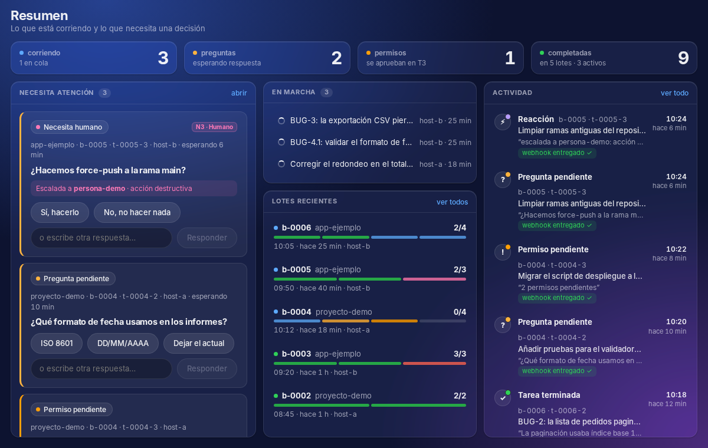

# Chopshop

Capa delgada entre tus bots y T3 Code. Un bot (o una persona) manda instrucciones; Chopshop las ejecuta como hilos de T3 en una o varias máquinas, vigila su progreso y avisa por webhook cuando un hilo necesita una respuesta.

**No es** un gestor de sesiones: la UI es delgada (solo lectura + responder preguntas), agnóstica de proveedor y sin agentes cloud.

- **Perfiles** por proyecto: repo, host, límites, reglas que se inyectan como preámbulo del prompt.
- **`fanout` / `gather`**: reparte tareas en hilos de T3 y recoge los resultados.
- **Eventos y webhooks**: `pending_question`, `task_done`, `batch_done`... por polling, con la URL leída siempre de un archivo.
- **Reacciones** (auto / bot / humano) y **grafo de tareas** que crece solo (triage, hijos, dependencias, roll-up).
- **Monitor de máquinas**: CPU/RAM/disco por host para decidir cuántos hilos caben.
- **App de macOS** (SwiftUI + React en un `WKWebView`) para ver el estado y responder preguntas.

## Estructura del monorepo

| Ruta | Qué es |
|---|---|
| `apps/agent/` | Servicio Python (solo stdlib): CLI `bin/chopshop`, motor, `chopshop/agent` (servicio headless por máquina), `tests/`, `tools/` |
| `apps/mac/` | `Chopshop.app` (SwiftUI + WKWebView): `Package.swift`, `Sources/`, `Resources/web` (bundle React), `build.sh`, `shot.sh` |
| `apps/ui/` | React de la app (esbuild); genera `apps/mac/Resources/web` |
| `packages/api/` | Cliente JS de la API del agente, tipos compartidos y la combinación de snapshots de varias máquinas que usa la UI |
| `docs/` | Arquitectura y contrato de la API del agente |
| `examples/` | Ejemplos (p. ej. lista de bugs de demostración) |
| `assets/` | Capturas de pantalla |
| `config.example.toml` | Plantilla de configuración con datos falsos |

La orquestación usa **Turborepo + pnpm workspaces** (solo JS/TS; los scripts de Python y Swift se envuelven como tareas de turbo).

## Instalación

Requisitos:

- Python 3.9 o superior (el motor usa solo la biblioteca estándar; hay un parser de YAML mínimo en `apps/agent/chopshop/miniyaml.py`).
- Node.js y [pnpm](https://pnpm.io) (para la UI, los tests del monorepo y las tareas de turbo).
- Un servidor de T3 Code accesible desde la máquina donde corre Chopshop.
- Solo para la app de Mac: macOS 13+ y Xcode (o las Command Line Tools, con Swift 6). Ver [`docs/mac-build.md`](docs/mac-build.md).

```sh
git clone <url-del-repo> chopshop && cd chopshop
pnpm install
mkdir -p ~/.config/chopshop && cp config.example.toml ~/.config/chopshop/config.toml   # luego edítalo
```

El CLI se ejecuta directamente desde el repo (`apps/agent/bin/chopshop`); no hay paso de build para el motor.

## Configuración

Todo lo específico de tu entorno (hosts, rutas, IPs, proyectos, identidades) vive en un archivo **local y sin versionar**:

```
~/.config/chopshop/config.toml
```

- La ruta se puede cambiar con `CHOPSHOP_CONFIG=/ruta/a/otro.toml`; si defines `XDG_CONFIG_HOME` se usa `$XDG_CONFIG_HOME/chopshop/config.toml`.
- El repo solo incluye [`config.example.toml`](config.example.toml), con datos **falsos** (`host-a`, `host-b`, `100.64.0.10`, `usuario@`, `proyecto-demo`...). Cópialo y adáptalo; no lo subas con datos reales.
- Secciones: `[general]` (estado local, host por defecto, host de desborde), `[hosts.<nombre>]` (`origin` del MCP de T3, `access`, `credential_file`, `t3_bin`, tope de hilos, finalidad), `[app]` (la app de Mac: `agent_url`, `token_file`, `refresh_seconds` y `[app.agents.<nombre>]` para varias máquinas) y `[agent]` (el servicio headless por máquina).
- Precedencia: valores por defecto genéricos < `config.toml` < variables de entorno.

### Variables de entorno

Cualquier clave se puede sobrescribir con `CHOPSHOP_<SECCION>__<CLAVE>` (doble guion bajo separa niveles; el guion `-` de un nombre se escribe `_`):

```sh
CHOPSHOP_AGENT__PORT=3791
CHOPSHOP_GENERAL__OVERFLOW_HOST=host-b
CHOPSHOP_HOSTS__HOST_B__CAP=6
CHOPSHOP_APP__AGENT_URL=http://100.64.0.10:3790
```

Además:

| Variable | Para qué |
|---|---|
| `CHOPSHOP_CONFIG` | Ruta del `config.toml` |
| `CHOPSHOP_HOME` | Directorio de estado local (por defecto `~/.chopshop`) |
| `CHOPSHOP_APP__AGENT_URL`, `CHOPSHOP_APP__TOKEN_FILE` | Solo la app de Mac: agente al que se conecta (ver abajo) |

### Webhooks y secretos

Las URLs de webhook y los tokens **nunca** van en el config ni en el código: solo la **ruta a un archivo** (modo `0600`, fuera del repo) que contiene la URL o el token. La URL se lee del archivo (`--webhook-file`, `subscribe` o `webhook_files` del agente) y no se imprime ni se escribe en logs ni en el estado.

### Perfiles

Los perfiles de proyecto son locales y tampoco se versionan: `~/.chopshop/profiles/<proyecto>.yaml` (modo `0600`). Campos principales: `repo`, `t3_project`, `host`, `overflow_host`, `remote_repos`, `provider`/`model` (opcionales), `runtime_mode`, `scratch`, `ready` (filtros), `branches.pattern`, `decider`, `can_run`/`cannot_run`, `autonomy`, `reactions`, `graph` e `integration` (ver [Integración en main](#integración-en-main)). Las reglas del perfil se inyectan como preámbulo del prompt de cada hilo.

```yaml
# ~/.chopshop/profiles/proyecto-demo.yaml
repo: ~/projects/proyecto-demo
t3_project: proyecto-demo
host: host-a
overflow_host: host-b
runtime_mode: approval-required
```

## Uso

```sh
apps/agent/bin/chopshop profile list | show <p> | check <p>
apps/agent/bin/chopshop fanout <proyecto> --from tasks.yaml [--max-parallel N] [--host H] [--dry-run] [--webhook-file F]
apps/agent/bin/chopshop fanout <proyecto> --task "texto" --task "otro"
apps/agent/bin/chopshop status
apps/agent/bin/chopshop poll   --webhook-file F        # una pasada: refresca estados y emite eventos
apps/agent/bin/chopshop watch  --interval 20 --webhook-file F   # bucle: envía el buzón, hace poll y late (watch.json)
apps/agent/bin/chopshop wait   <batch> --webhook-file F --timeout 600
apps/agent/bin/chopshop answer <task> "respuesta" [--request R] [--queue]   # --queue la deja en el buzón y la envía watch/poll
apps/agent/bin/chopshop snapshot [--events N]          # JSON de solo lectura del estado local (lo usa la UI; no llama a T3)
apps/agent/bin/chopshop metrics                        # CPU/RAM/disco de esta máquina (JSON; los remotos los da su agente)
apps/agent/bin/chopshop stop [<batch>] [--task T]      # interrumpe hilos y marca tareas en cola como canceladas (nunca archiva)
apps/agent/bin/chopshop gather <batch> [--json]        # resultados en Markdown
apps/agent/bin/chopshop settle <batch>                 # t3_thread_organize settle (nunca archiva)
apps/agent/bin/chopshop integrate <batch|task> [--dry-run] [--json] [--webhook-file F]   # rebase + tests + push a la base + settle
apps/agent/bin/chopshop integrate --thread ID --host H --project P                       # un hilo suelto de T3
apps/agent/bin/chopshop subscribe --project P --events pending_question,task_done --webhook-file F
apps/agent/bin/chopshop graph new proyecto-demo --bugs examples/dummy-bugs.yaml
apps/agent/bin/chopshop graph run g-0001 | status [g-0001] [--json]
```

`tasks.yaml` es una lista de `{title, prompt, issue?, labels?, assignee?}`. Sin demonio: cada comando es una pasada de polling; `watch` es el bucle que mantiene todo al día.

### Enrutado de host

- Por defecto, el host del perfil (`host-a` en los ejemplos), con un tope de hilos en paralelo.
- Los lotes grandes pueden desbordarse a `overflow_host` (`host-b`), pensado para tareas de solo tests: el preámbulo prohíbe dev servers y deploys.
- Se puede forzar con `--host`.
- Conexión con T3: cliente MCP nativo (`apps/agent/chopshop/t3mcp.py`, solo stdlib). Sin `origin` el host es local (el origen sale de `~/.t3/userdata/server-runtime.json`); con `origin = "http://100.64.0.11:3773"` es el T3 de otra máquina. El cliente se autentica solo: pide un pairing de un solo uso a `t3_bin` en local, hace OAuth+PKCE y cachea el token en `<CHOPSHOP_HOME>/t3-credential.json` (0600, o `credential_file`). Ya no se usan el CLI `fleet` ni el helper node `t3mcp.mjs`.
- Métricas de hosts remotos: no se recolectan desde aquí; cada máquina corre su propio `chopshop-agent` y la app de Mac las combina.

### Webhooks y eventos

Eventos: `pending_question` (con `summary`, `options`, `request` y el comando `reply`), `task_done`, `batch_done`, `task_integrated` (con `batch`, `task`, `thread`, `branch`, `base`, `commit` y `settled`; lo emite `chopshop integrate` solo tras un push correcto), además de los de reacciones y grafo. Las entregas quedan registradas en `~/.chopshop/events.jsonl`.

### Integración en main

`chopshop integrate <batch|task>` lleva a la base el trabajo de un hilo que **terminó** (`completed`, sin preguntas ni permisos pendientes). Con un lote, integra en orden cada tarea con hilo. Rama y worktree salen de T3 (`t3_thread_read` → `thread.branch` y `thread.worktreePath`): Chopshop no crea worktrees, trabaja en el que creó T3, así que se corre en la máquina donde está ese worktree. Pasos:

1. El worktree debe estar limpio (`git status --porcelain` vacío) y en la rama del hilo; si no, aborta (`dirty` / `wrong_branch`).
2. `git fetch origin` y `git rebase origin/<base>` (`base_ref` del perfil, `main` por defecto). Si hay conflicto: `git rebase --abort` y estado `conflict`.
3. Corre `integration.test_cmd` en `integration.test_cwd` (relativo al worktree) con `integration.timeout` (900 s por defecto). Sin `test_cmd` no se integra nunca (`no_tests`); si fallan, `tests_failed`.
4. `git push origin HEAD:<base>`, **nunca** con `--force`, `-f`, `--force-with-lease` ni refspecs `+`: el módulo tiene una guardia que rechaza ese push antes de ejecutarlo. Si el remoto lo rechaza porque la base avanzó, reintenta hasta 2 veces fetch + rebase + tests; después, `push_rejected`.
5. Solo si el push salió bien: `t3_thread_organize {action: settle}` (nunca archiva), `integrated: true` en la tarea y evento `task_integrated`.

`--dry-run` hace los pasos 1-3 sin push ni settle; `--json` da el resultado por tarea (`status`, `steps`, `detail`, `commit`...). El código de salida es distinto de 0 si alguna tarea no quedó integrada (las ya integradas cuentan como hechas).

```yaml
# en ~/.chopshop/profiles/proyecto-demo.yaml
base_ref: main
integration:
  test_cmd: [python3, -m, unittest, discover, -s, tests]   # lista argv, sin shell
  test_cwd: apps/agent                                     # relativo al worktree del hilo
  timeout: 900                                             # segundos
```

### Reacciones por eventos

El bloque `reactions:` del perfil se interpreta (`apps/agent/chopshop/reactions.py`). Tres niveles, resueltos de más barato a más caro (humano > bot > auto cuando varias reglas coinciden):

| Nivel | Quién actúa | Ejemplo |
|---|---|---|
| 1 · auto | Chopshop mismo | `task_done` → settle; `task_failed` → reintentar una vez; `task_stalled` (sin progreso `after` s) → interrumpir y reintentar una vez |
| 2 · bot | webhook `reaction` (`level: bot`) a la suscripción `notify`; el bot contesta con `chopshop answer … --by bot`; pasado `escalate_after` sin respuesta sube a `escalate_to` | `pending_question` que pide criterio |
| 3 · humano | webhook `reaction` (`level: human`); la tarea queda con una escalación abierta → «Necesita humano» en la UI hasta que alguien responde | petición irreversible (push a main, borrar) |

```yaml
reactions:
  - {on: task_done, do: settle}
  - {on: task_failed, do: retry_once, then: escalate, notify: humano-demo}
  - {on: task_stalled, after: 120, do: retry_once, notify: humano-demo}
  - {on: pending_question, match: "approach|which", level: bot, notify: bot-demo, escalate_after: 300, escalate_to: humano-demo}
  - {on: pending_question, match: "push|delete|force", level: human, notify: humano-demo}
```

- Opt-in por lote: al crear el lote se marca `rx: true` si el perfil tiene `reactions`.
- Una tarea con pregunta/permiso pendiente, escalación abierta o espera al bot no cuenta como «sin progreso».
- Un reintento crea una tarea nueva (`retry_of`); el hilo viejo se settlea, nunca se archiva.
- `apps/agent/tools/sim_receivers.py` levanta un «bot» y un «humano» simulados en `127.0.0.1` para probar el flujo en local.

### Grafo de tareas

Un árbol de tareas que **crece solo** (`apps/agent/chopshop/graph.py`): meta raíz → hilo de *triage* → un nodo por bug → hijos si un bug es grande, con dependencias entre nodos.

- **Triage:** un hilo de solo texto lee la lista de bugs y devuelve JSON `[{"bug","depends_on"}]`; si es inválido cae a nodos planos y registra una excepción.
- **Hijos:** un nodo con `hint: split` se divide en hasta 3 hijos; pasar de `max_depth` hace fallar el nodo.
- **Planificador:** libera en paralelo los nodos cuyas dependencias están `done`, hasta `min(tope del host, cupo por rendimiento)`. Con CPU alta reduce a la mitad; con CPU/RAM saturadas solo deja correr lo que ya corre. Si una dependencia falla, los dependientes quedan `skipped`.
- **Roll-up:** cuando todos los hijos son finales, el padre se resuelve de forma determinista (`done: all` o `done: ratio`).
- **El bot despierta solo en excepciones:** pregunta con criterio → nivel 2, irreversible → nivel 3, todo lo demás se resuelve solo (nivel 1).

```yaml
graph:
  max_depth: 2        # profundidad máxima del árbol
  thread_budget: 12   # hilos totales por grafo
  done: all           # all | ratio
  min_ratio: 0.8
  throttle_cpu: 75
  stop_cpu: 100
  stop_ram: 92
```

`examples/dummy-bugs.yaml` es una lista de bugs falsos para probarlo.

## App de macOS

`apps/mac`: ejecutable SwiftPM `ChopshopUI` (SwiftUI, macOS 13+; vidrio líquido en macOS 26) con `NavigationSplitView` y un `WKWebView` transparente que carga la app React (`apps/ui`). Es un **cliente puro de la API del agente** ([`docs/agent-api.md`](docs/agent-api.md)): no ejecuta Python ni habla con T3, y se empaqueta como un único `Chopshop.app`. Vistas: **Resumen**, **Preguntas** (responder), **Actividad**, **Reacciones**, **Lotes**, **Máquinas** (CPU/RAM/disco por app y proyecto) y una vista por proyecto. Los permisos (approvals) son de solo lectura: se aprueban en T3.

### Build

```sh
pnpm install
pnpm app              # construye la UI y apps/mac/dist/Chopshop.app (firma ad-hoc, sin Python)
```

Guía completa (requisitos, token, primera apertura y solución de problemas): [`docs/mac-build.md`](docs/mac-build.md).

Release firmada, notarizada y con auto-actualización (Sparkle + Cloudflare R2): [`docs/release.md`](docs/release.md).

### Conexión con los agentes

La app lee la sección `[app]` de `~/.config/chopshop/config.toml` (plantilla: [`config.example.toml`](config.example.toml)):

```toml
[app]
agent_url = "http://100.64.0.10:3790"
token_file = "~/.chopshop/agent/token"   # ruta a un archivo con el token, nunca el token
refresh_seconds = 3

[app.agents.host-b]                      # opcional: más máquinas, combinadas en una sola vista
url = "http://100.64.0.11:3790"
token_file = "~/.chopshop/agent/host-b.token"
```

Entorno (tiene prioridad): `CHOPSHOP_APP__AGENT_URL`, `CHOPSHOP_APP__TOKEN_FILE`, `CHOPSHOP_APP__REFRESH_SECONDS`, `CHOPSHOP_APP__AGENTS__HOST_B__URL`, `CHOPSHOP_APP__AGENTS__HOST_B__TOKEN_FILE`. Si un agente no responde (red caída, 401/403), la UI lo muestra («agente no alcanzable», «acceso denegado») y conserva los últimos datos marcados como viejos; nunca se cierra por eso.

### Cómo funciona

- Cada `refresh_seconds` la app consulta `GET /snapshot` de cada agente (URLSession, con `Authorization: Bearer <token>` leído del archivo en cada petición; el token no se imprime ni se guarda) y entrega los resultados crudos a la UI web, que los combina por `machine_id` (`packages/api/src/view.js`).
- Puente JSON `{type, payload, id?}`. JS→Swift (`window.webkit.messageHandlers.chopshop.postMessage`): `ready`, `refresh`, `navigate`, `openLink` y las acciones `answer` y `settle` (las únicas escrituras; el resto es de solo lectura; cada una un `POST` de la API al agente indicado en `agent`). Swift→JS (`window.chopshop.receive`): `agents`, `select`, `error`, `actionResult`.
- Argumentos de la app: `--select overview|questions|batches|events|project:<nombre>`, `--capture`.

### Permisos de macOS

- `screencapture` por ssh falla (sin permiso de Screen Recording): la app captura su propia ventana con `--capture` y `apps/mac/shot.sh <salida.png> <sección>` (protocolo: archivo `/tmp/chopshop-shot.req` con `<sección> <ruta>`, opcional `/tmp/chopshop-shot.js`).
- La app solo hace peticiones HTTP a las URLs de tu `config.toml`; no lanza procesos hijos. Si macOS pregunta por «Red local», acéptalo.

### Capturas

Las capturas de la interfaz están en `assets/` y usan datos de demostración.

Para regenerarlas con datos de ejemplo, ver [`docs/screenshots.md`](docs/screenshots.md).



## Agente headless por máquina

`apps/agent/chopshop/agent` es el servicio (v0.6, en desarrollo) que corre sin interfaz en cada máquina: mide CPU/RAM/disco por app y proyecto, guarda el historial en SQLite, vigila los hilos de T3 y expone una API HTTP por Tailscale. La app pasa a ser un cliente puro. Diseño en [`docs/agent-architecture.md`](docs/agent-architecture.md) contrato en [`docs/agent-api.md`](docs/agent-api.md) e instalación como servicio `systemd --user` en [`docs/agent-service.md`](docs/agent-service.md). Su configuración vive en la sección `[agent]` del `config.toml`.

## Checks estáticos

El repo no tiene tests unitarios: se valida con checks estáticos (también en CI, `.github/workflows/lint.yml`).

```sh
uv sync && pnpm install   # dependencias de desarrollo (ruff, mypy, typescript, eslint)
pnpm lint                 # ruff + mypy, tsc --noEmit, eslint y la regla «sin comentarios»
pnpm lint:swift           # swiftlint (macOS, apps/mac/.swiftlint.yml)
pnpm check                # compileall, node --check y bash -n
```

El código no lleva comentarios: lo prohíben `scripts/check-no-comments.py` (Python, shell, workflows, CSS y `.d.ts`), la regla `local/no-comments` de ESLint y la regla `no_comments` de SwiftLint.

## Seguridad y datos personales

El repo no contiene rutas de usuario, nombres reales de hosts, IPs, correos, URLs de webhook ni tokens: todo eso va al `config.toml` local, a los perfiles de `~/.chopshop` o a archivos referenciados por ruta. Si añades ejemplos, usa datos falsos (`host-a`, `100.64.0.10`, `usuario@`, `proyecto-demo`).

## Límites conocidos

- En modo `approval-required` T3 no deja que un agente edite archivos sin una aprobación que solo se resuelve en su UI (por MCP no se puede aprobar). Los hilos devuelven un diff; para que editen por sí mismos hace falta full-access o aprobar a mano.
- Las aprobaciones de comandos (command-permission) solo se pueden dar desde la UI de T3; `answer` cubre solo preguntas.
- Sin eventos push de T3: hay que correr `watch` (o un cron/launchd/systemd que lo lance).
- Los lotes mixtos de host no están soportados.
- Las reacciones solo corren dentro de `chopshop watch`/`poll`, no en la app.

## Licencia

Licencia: MIT, ver [LICENSE](LICENSE).
