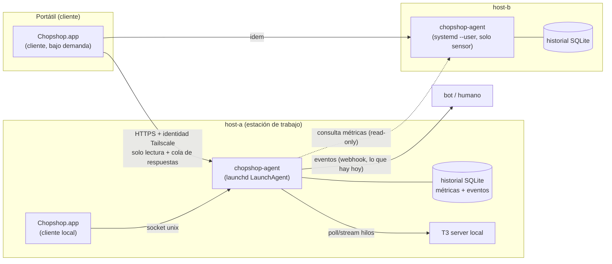

# Propuesta: agente headless por máquina + app cliente (Chopshop v0.6)

**Estado: solo propuesta (28 oct 2026). No se instaló ni se cambió nada en ninguna máquina.**

## Objetivo

1. Un agente liviano y sin interfaz en cada máquina (launchd en macOS, unidad de usuario de systemd en Linux) que mide CPU/RAM/disco por **app** y por **proyecto**, guarda historial, vigila los hilos de T3 y emite eventos.
2. La app SwiftUI pasa a ser un **cliente puro**: se abre bajo demanda desde cualquier máquina, por Tailscale. Si no está abierta no corre nada suyo.
3. La estación de trabajo debe poder usarse como estación de trabajo sin que Chopshop estorbe (sin ventanas, sin Dock, sin picos de CPU, sin avisos de permisos).
4. **No es Telar:** el agente no gestiona sesiones (no lanza, adjunta, mata ni multiplexa terminales o sesiones de agentes). Observa, guarda y ejecuta las pocas órdenes que Chopshop ya tiene (`answer`, `settle`, reacciones/grafo).

## Diagrama

Una máquina hace de **orquestador** (hoy host-a: lotes, grafos, reacciones, `watch`); las demás son **solo sensores**. El cliente habla con cada agente y une la vista; nunca hay escritura concurrente sobre el mismo estado.

## Qué hace el agente

| Función | Cómo | Frecuencia |
|---|---|---|
| CPU/RAM por proceso → agrupado por **app** (bundle del `.app`, o ejecutable en Linux) y por **proyecto** (cwd/ruta del proceso cae dentro de un proyecto registrado, o el hilo de T3 que lo lanzó) | `ps -axo pid,ppid,rss,pcpu,comm` + `proc_pid_path`/`/proc`; sin permisos especiales | 10 s (con retroceso a 30–60 s si la carga > 6) |
| Totales de máquina (CPU, RAM, swap, carga, red) | `host_statistics` / `/proc` | 10 s |
| Disco: libre por volumen y tamaño por proyecto | `statfs` y `du` en proyectos con `taskpolicy -b`/`nice 19` | libre 60 s; `du` cada 15 min |
| Historial | SQLite (WAL): crudo 24 h; agregado 1 min 30 días; 1 h un año | continuo |
| Hilos de T3 | el `watch` actual vive dentro del agente (poll → después push si T3 lo ofrece) | 5 s |
| Eventos | se escriben en `events` (monotónicos por máquina: `machine_id` + `seq`) y se despachan a webhooks como hoy | al ocurrir |
| Alertas de umbral | p. ej. app que pasa de 4 GB o disco < 10 % → evento `machine_alert` | al ocurrir |

API local mínima (JSON): `GET /snapshot`, `GET /metrics?from=&to=&group=app|project`, `GET /events?after=<seq>` (con SSE opcional), `POST /answer` (a la cola del buzón), `POST /settle`. **Sin** endpoints para ejecutar comandos, abrir shells ni tocar sesiones.

## Cliente

- La app deja de ejecutar `chopshop snapshot` por su cuenta: pide `/snapshot` al agente local (socket unix, sin red) o al remoto (Tailscale). Misma UI actual (React en WKWebView), cambia solo el origen de datos y un selector de máquina.
- Cierra y no pasa nada: el estado y el historial viven en el agente. Abrirla en cualquier máquina muestra lo mismo.
- Respuestas desde la UI → `POST /answer` → buzón del orquestador → T3 (igual que hoy, pero sin que un proceso hijo de una app GUI toque la red; ver riesgos).

## Instalación y actualización

- **Instalar:** `chopshop-agent install` (idempotente, requiere confirmación).
  - macOS: `~/Library/LaunchAgents/local.chopshop.agent.plist` con `RunAtLoad`, `KeepAlive`, `ProcessType=Background`, `LowPriorityIO`, `Nice=10`, `SoftResourceLimits` de memoria; `launchctl bootstrap gui/$UID`. Es un **LaunchAgent** (sesión del usuario), no un daemon de sistema.
  - Linux: `~/.config/systemd/user/chopshop-agent.service` con `Nice=10`, `MemoryMax=96M`, `CPUQuota=10%`; `loginctl enable-linger`.
- **Distribución:** el repo/tarball versionado (como `sync.sh`, pero a un directorio `~/.chopshop/agent/releases/<versión>`); `current` es un symlink.
- **Actualizar:** descargar → verificar hash → `ln -sfn` → `launchctl kickstart -k` / `systemctl --user restart`; healthcheck (`/health`, 10 s); si falla, vuelve al symlink anterior. El esquema SQLite lleva `user_version` y migra hacia adelante. Cliente y agente negocian `api_version`; el cliente avisa si el agente es más viejo.
- **Desinstalar:** `chopshop-agent uninstall` quita plist/unidad y deja los datos salvo `--purge`.
- En host-b solo se instalaría el modo **sensor** (sin `watch`, sin hilos) y solo con aprobación explícita: hoy esa máquina no debe correr procesos de trabajo.

## Consumo esperado (estimación; hay que medirlo)

| | Python stdlib (reusa código actual) | Binario nativo (Swift/Go), opcional después |
|---|---|---|
| RAM residente | 25–40 MB | 8–15 MB |
| CPU en reposo | 0.3–0.8 % de un núcleo (muestreo 10 s) | < 0.2 % |
| Disco (historial) | ~15–30 MB/mes por máquina con los agregados anteriores | igual |
| Red | ~0 salvo clientes conectados (~2 KB por snapshot) | igual |

Meta: **< 1 % de CPU y < 50 MB** de media; si la carga de la máquina sube, el agente espacia el muestreo en vez de competir.

## Para que host-a sea usable como estación de trabajo

- Sin app residente: la UI no corre salvo que se abra; el agente no tiene ventana, Dock ni icono en la barra.
- Prioridad baja de CPU y de disco (`Background`, `LowPriorityIO`, `taskpolicy -b`); el `du` pesado va fuera de horas y se cancela si la carga sube.
- Sin Accesibilidad, sin Grabación de pantalla, sin Automatización: no hay avisos de permisos durante el trabajo.
- Límites de memoria/CPU y un `--quiet` que solo emite eventos y no muestrea disco.
- Los hilos de trabajo (T3) ya son un coste aparte y se regulan con el planificador del grafo (perf gate), no con el agente.

## Riesgos y decisiones abiertas

1. **Autenticación por la red Tailscale.** Opciones: (a) escuchar solo en la IP/interfaz de Tailscale y usar `tailscale whois` para identificar al cliente (sin tokens, ACL por etiqueta `tag:chopshop`); (b) `tailscale serve` con cabeceras de identidad; (c) token de portador en archivo chmod 600. Recomendado: (a)/(b) + ACL; escritura (`answer`/`settle`) solo para la identidad del dueño; todo lo demás solo lectura. Nunca escuchar en `0.0.0.0`.
2. **Permisos de macOS (TCC).** Leer un volumen externo exige que el binario del agente tenga acceso (hallazgo ya visto con la app). Hay que concederlo una vez (Archivos y carpetas / Acceso total al disco) **al binario del agente con identidad de firma estable**: una firma ad-hoc nueva en cada actualización cambia el `cdhash` y puede perder la concesión. Propuesta: firmar con un certificado de desarrollo propio o instalar siempre el mismo ejecutable «lanzador» fijo que carga el código versionado.
3. **Permiso de red local (hallazgo ya visto).** Los procesos hijos de la app GUI se colgaban al hablar con T3 (que escucha en una IP no-loopback) mientras que el mismo comando por ssh respondía al instante; causa probable, no verificada: heredan la privacidad de «Red local» y nadie puede pulsar el aviso. Un LaunchAgent no es hijo de la app, pero **hay que verificarlo** antes de asumirlo (probar un LaunchAgent mínimo contra T3 y contra otra máquina de la red Tailscale). Mitigación: el agente es el único que habla con T3 y con otras máquinas; la app solo habla con el agente por socket unix/Tailscale. Si fuera necesario, concederlo a mano una vez o hacer que T3 escuche también en loopback.
4. **Sincronización de estado.** Un solo escritor por máquina (cada agente es dueño de sus métricas/eventos); el orquestador es dueño de lotes/grafos/reacciones. Sin replicación multi-escritor: el cliente consulta y cachea con `seq` por máquina (`?after=`). Si el orquestador cae, los sensores siguen guardando historial y se pone al día al volver. Riesgo: reloj desfasado entre máquinas → usar timestamps del agente y mostrar el desfase.
5. **Estado y reinicios.** El estado actual (`state.json` con candado) pasa a SQLite o se conserva con el mismo candado; la migración debe ser reversible (copia `state.json.bak`).
6. **host-b.** Regla actual: nada de procesos de trabajo ahí. El sensor es mínimo pero igual requiere aprobación explícita antes de instalarse.
7. **Fallos silenciosos.** Sin UI abierta, nadie ve que el agente murió: `KeepAlive`/`Restart=on-failure`, latido en `/health` y un evento `agent_down` emitido por el orquestador cuando falta el latido de un sensor.
8. **Superficie de ataque.** Una API de red en host-a aunque sea solo por Tailscale: sin ejecución de comandos, límites de tamaño, registro de accesos, y apagarla con `--no-remote` si solo se usa local.

## Fuera de alcance (no-Telar)

- Sin gestión de sesiones: no lanza ni cierra agentes/terminales, no mantiene PTYs, no reconecta ni reparte sesiones entre máquinas.
- Sin ejecución remota arbitraria, sin editor ni gestor de archivos.
- Los hilos siguen siendo de T3; Chopshop solo los lee, los marca (`settle`) y responde preguntas.

## Plan por fases

1. **Medición** (sin servicio): prototipo del colector por app/proyecto, ejecutado a mano 48 h en host-a; medir CPU/RAM reales y ajustar la tabla de consumo.
2. **Agente local en host-a** (LaunchAgent) con `/snapshot` y socket unix; la app lee de ahí; `watch` se mueve dentro del agente.
3. **Acceso remoto por Tailscale** con identidad y solo lectura; luego `answer`/`settle` para el dueño.
4. **Sensor en host-b** (con aprobación) y vista multi-máquina.
5. Opcional: reescribir el agente en binario nativo si la medición lo justifica.
