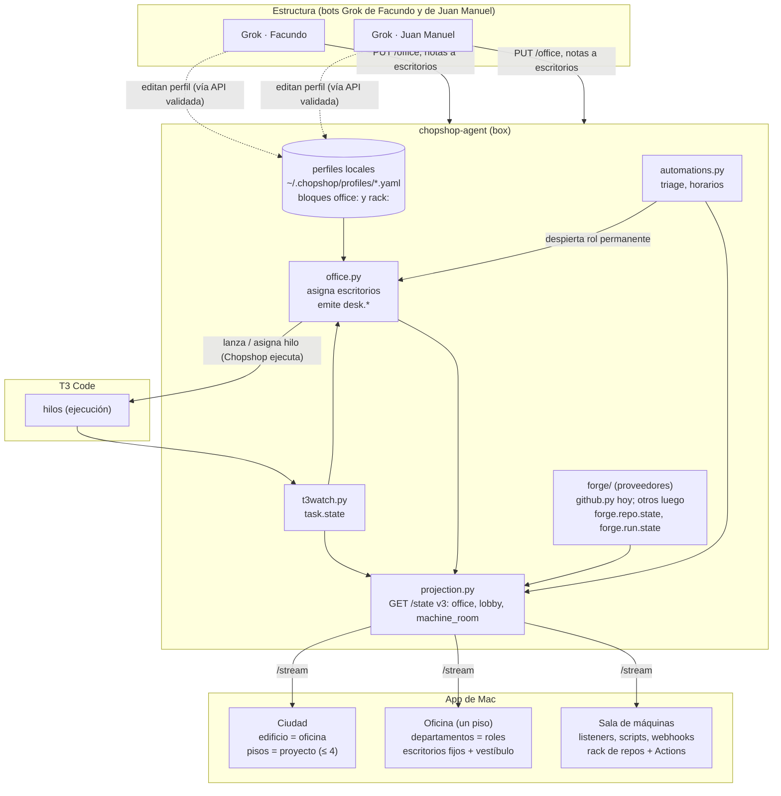

# Plan: rediseño de la oficina (pisos por proyecto, escritorios por rol, sala de máquinas)

**Estado: en implementación en la rama `feat/office-redesign` (fases 0–7 del agente y de la app; ver la tabla de fases). Decisiones provisionales: slugs y logins con marcadores (`<org>/<repo-principal>`, `<login-grok-…>`), GitHub sigue entrando por polling (sin ruta de webhooks entrantes), escritorios solo en el orquestador.** Parte de lo que existía:

- Agente: `apps/agent/chopshop/agent/projection.py` pliega sobres en `GET /state` (`projects[].tasks/batches/graphs/attention`,
  `counts`, `recent`); `t3watch.py` mantiene `t3_threads` y emite `task.state`; `github.py` hace polling con ETag
  (`github.issue.*`, `github.pr.*`, `github.ci.completed`); `automations.py` corre scripts locales por evento u horario;
  `webhooks.py` reparte sobres a las suscripciones (salientes). Estado local: SQLite del agente y `chopshop/state.py`
  (`~/.chopshop/state.json`).
- App de Mac: `Live/LiveState.swift` (misma regla `apply` que el agente); `City/CityModel.swift` (un edificio por empresa,
  un piso por proyecto, una ventana por hilo vivo, `CompanyDirectory` fija en código); `IsoScene.swift` /
  `IsoOfficeView.swift` (una sala por **rango de dependencias** del grafo, un escritorio por **tarea**; los escritorios
  aparecen y desaparecen con las tareas).

El rediseño cambia el eje de la oficina: hoy se organiza por tareas y grafo; pasa a organizarse por **lugares estables**
(piso → departamento/rol → escritorio) que los hilos de T3 ocupan y heredan.

## Diagrama



## Conceptos y reglas

### 1. Pisos solo para proyectos

- Un edificio = una **oficina** (empresa: Personal, iAware, ozom, Bixku, Awesome GB…). Cada piso pertenece a **un solo
  proyecto**; no hay pisos compartidos ni pisos por rol.
- Los roles/departamentos viven **dentro** del piso (salas), nunca como pisos extra.
- Un proyecto puede tener varios pisos: **tope de 4 pisos por proyecto** (`MAX_FLOORS_PER_PROJECT = 4`) y **24
  escritorios por piso** (hasta 6 departamentos de hasta 6 escritorios). Un perfil que pida más se rechaza en
  `chopshop profile check`. Tope de edificio: 16 pisos de proyecto (más la planta baja).
- La planta baja de cada edificio no es de ningún proyecto: es el **vestíbulo** (punto 3).
- `CompanyDirectory.standard` deja de estar fija en código: la empresa sale de `office.company` del perfil (la tabla
  actual queda como respaldo para perfiles sin bloque `office`).

### 2. Escritorios fijos por rol

- Un escritorio es un **hueco estable** con id `<proyecto>/<piso>/<rol>/<n>` (p. ej. `awesome-gb/0/backend/2`). Lo
  declara el perfil; nunca se borra. Si el perfil deja de declararlo, queda `retired: true` (se pinta vacío y gris);
  solo un humano puede reactivarlo o pedir que se oculte.
- Cuando arranca un hilo de T3 con rol, `office.py` le asigna el **primer escritorio libre** de su rol en su proyecto
  (piso más bajo primero) y emite `desk.assigned`. Si el rol está lleno, el hilo espera en el vestíbulo con la
  etiqueta del rol (`desk.waiting`) y sube en cuanto se libera uno.
- Cuando el hilo termina, el escritorio pasa a **en semivida** (punto 7): el ocupante sigue visible y se desvanece. Un
  hilo nuevo del mismo rol **hereda** el escritorio: si hay uno en semivida, el anterior sale de inmediato
  (`desk.released`, `reason: inherited`) y el nuevo entra con la **herencia**: id del hilo anterior, resumen final,
  rama, worktree y PRs (lo que ya trae `task.state`), para que el prompt de arranque pueda citarlo.
- Cada escritorio guarda su **linaje** (últimos 20 ocupantes con desde/hasta/motivo) en SQLite; la proyección manda los
  últimos 5.
- Cómo se sabe el rol de un hilo, por prioridad: (a) `role` explícito en el cuerpo de `task.state` cuando Chopshop
  lanza el hilo (lote/grafo/rol permanente); (b) reglas `match` del perfil (regex sobre el título del hilo, prefijo de
  rama, etiqueta); (c) asignación manual de un bot (`POST /desks/<id>/assign`). Sin rol → vestíbulo.

### 3. Vestíbulo (sala general)

- Uno por edificio, en la planta baja. Solo hilos **activos** (`running`, `starting`, `waiting`, `queued`, `pending`
  de `t3watch.ACTIVE`) **sin rol**, más los que esperan escritorio (marcados con su rol).
- Los hilos sin rol que terminan se desvanecen en el vestíbulo con la misma semivida y salen; no suben a ningún piso.
- Si un bot le asigna rol a un hilo del vestíbulo, el hilo sube a su escritorio (`desk.assigned`, `reason: manual`).

### 4. Sala de máquinas (vista aparte)

Tercera vista de la app (Ciudad · Oficina · **Sala de máquinas**), no un piso del render de la oficina. Contiene:

- **Listeners**: los hilos del agente (`t3watch`, `github`/forge, repartidor de webhooks, planificador de
  automatizaciones, collector) con estado (ok/degradado/caído, último ciclo, backoff). Hoy esto solo se deduce de
  `machine.health`; se publica explícito con `listener.state`.
- **Scripts de triage y demás automatizaciones** (`automations:` del perfil): última ejecución, disparador, exit,
  duración, próximo horario (de `automation.ran` y los cursores de `meta`).
- **Webhooks**: suscripciones salientes (`GET /subscriptions`, sin URLs) con último envío ok/fallo; y, cuando exista,
  la entrada de webhooks (ver preguntas abiertas: hoy GitHub entra por polling).
- **Rack de servidores**: un módulo por repositorio con **luz de estado**:
  - verde: CI de la rama por defecto en `success` y sin runs fallidos recientes;
  - ámbar parpadeante: hay runs en curso o en cola;
  - rojo: último run de la rama por defecto fallido, o PR con CI rojo que pide atención;
  - gris: sin datos / proveedor degradado (rate limit, `gh` caído).
- **Awesome GB** tiene dos módulos: el **repo principal del proyecto** (`kind: main`) y **Engine CX**
  (`kind: docs`, documentación). Los slugs viven en el perfil local, no en el repo.
- **GitHub Actions en curso**: cada run visible en su módulo con workflow, estado, **disparador** (`push`,
  `pull_request`, `schedule`, `workflow_dispatch`, `repository_dispatch`, …), rama/sha y **origen**: qué lo disparó.
  Origen, por prioridad:
  1. `thread`: la rama o el sha coinciden con la rama/worktree de un hilo (`task.state.branch/worktree`), o el actor
     es la cuenta que usa ese hilo → se muestra el escritorio/rol del hilo;
  2. `automation`: una automatización emitió `forge.dispatch` (repo, workflow, ref, nonce en `inputs`) y el run lo
     lleva;
  3. `bot`: el actor es una cuenta de bot declarada en `rack.actors` (p. ej. los Grok);
  4. `schedule`: disparador `schedule`;
  5. `human` (actor conocido) o `unknown`.
- **Agnóstico de proveedor**: el rack habla de `provider` + `repo` + `runs`. `github.py` se mueve a
  `agent/forge/github.py` y se añade una interfaz `ForgeProvider` (`poll_events`, `poll_runs`, `repo_status`);
  GitLab/Gitea/Forgejo se suman después con su adaptador sin tocar la proyección ni la app. Los tipos actuales
  `github.*` se mantienen un ciclo y se añaden los genéricos `forge.*`.

### 5. Roles permanentes por oficina

- Un rol puede declararse `permanent: true`: su escritorio existe siempre aunque no haya hilo (se pinta "dormido").
  Ejemplo: **triage** en la oficina de Awesome GB, con su propio escritorio en el piso principal.
- **Despertar**: reutiliza los disparadores de `automations.py` (`type: <evento>` con `where`, `schedule` con
  `cron`/`every`, `manual`) más `desk.note`. Ejemplo: `cron: "30 8 * * 1-5"` (hora local de la box) y
  `github.issue.opened` sin etiqueta `triaged`.
- Al despertar, Chopshop lanza **un hilo de T3** (lote de una tarea, `role: triage`) en ese escritorio con el prompt
  del rol (`prompt_file` local) + la herencia del ocupante anterior + las **notas pendientes** del escritorio. Una
  sola instancia viva por escritorio permanente (si ya hay un hilo activo, el disparo se encola como nota).
- **Notas de bots para preparar el día**: `POST /desks/<id>/notes {from, text, ttl_s?}` (credencial de dispositivo o
  de bot). Se guardan en la bandeja del escritorio y se consumen al despertar (o las lee el hilo activo en su próximo
  turno vía `t3_thread_send`, que es un mensaje interno a T3, no un envío externo).
- El hilo de triage revisa pendientes (issues sin triage, PRs con CI rojo, preguntas abiertas en `attention`) y deja
  su resultado como sobres (`triage.result`) y comentarios **solo con permiso** (ver restricciones).

### 6. Responsabilidades

| quién | hace | no hace |
|---|---|---|
| Bots Grok (Facundo y Juan Manuel) | mantienen la estructura: pisos, departamentos, escritorios, roles permanentes, rack, actores; asignan rol a hilos del vestíbulo; dejan notas en escritorios | no ejecutan código ni lanzan hilos; no borran escritorios (solo `retired`) |
| Chopshop | ejecuta todo vía hilos de T3: lanza, asigna, responde, hace `settle`, corre automatizaciones | no cambia la estructura por su cuenta |
| Humano | aprueba lo que exige permiso (abajo) | — |

Toda escritura de estructura entra por la API del agente (`PUT /office/<proyecto>`), se valida igual que
`profile check`, reescribe el bloque del perfil local y emite `office.changed {by}`.

### 7. Semivida de hilos terminados

- Un hilo terminado (`done`, `failed`, `settled`) sigue visible y su opacidad baja como
  `0.5 ^ (t / T½)`, con `t` = tiempo desde `max(ended_at, touched_at)`.
- **T½ = 30 min** por defecto (perfil: `office.half_life`); los fallidos usan **2 × T½**.
- Sale de la oficina cuando la opacidad baja de 0.1 (≈ 3,3 T½ ≈ 100 min) y emite `desk.released`
  (`reason: faded`). Si mientras tanto llega un heredero, sale antes (`reason: inherited`).
- **Tocar** reinicia el reloj: responder, enviar mensaje, abrir el inspector desde la app (`POST /touch`), asignar o
  dejar nota. Un hilo con `attention` abierta **no se desvanece** hasta que se cierra.
- El cálculo de opacidad es una función pura compartida (agente y app) para que `state == fold(apply, sobres)` siga
  valiendo; el agente decide la salida con un temporizador y la publica como sobre.

## Cambios de modelo de datos

### Perfil local (sin versionar, `~/.chopshop/profiles/<proyecto>.yaml`)

```yaml
project: awesome-gb
office:
  company: Awesome GB
  half_life: 30m
  floors:                       # ≤ 4
    - name: Producto
      rooms:                    # ≤ 6 por piso, ≤ 24 escritorios por piso
        - {role: triage, desks: 1, permanent: true}
        - {role: backend, desks: 4}
        - {role: frontend, desks: 3}
    - name: Docs
      rooms:
        - {role: docs, desks: 2}
  roles:
    triage:
      prompt_file: roles/triage.md            # relativo a ~/.chopshop/automations/awesome-gb/
      wake:
        - {type: schedule, cron: "30 8 * * 1-5"}
        - {type: github.issue.opened, where: {body.labels: {not: triaged}}}
        - desk.note
    backend:
      match: {title: "^\\[be\\]", branch: "^be/"}
rack:
  repos:
    - {provider: github, repo: "<org>/<repo-principal>", kind: main}
    - {provider: github, repo: "<org>/<engine-cx>", kind: docs, label: Engine CX}
  actors:
    "<login-grok-facundo>": {kind: bot, label: Grok · Facundo}
    "<login-grok-juan-manuel>": {kind: bot, label: Grok · Juan Manuel}
```

`[agent.github] repos` de `config.toml` sigue valiendo; `rack.repos` lo complementa por proyecto.

### Agente (SQLite, esquema siguiente)

- `desks(id PK, project, floor, role, slot, permanent, retired, created)`
- `desk_occupancy(desk_id, thread_id, since, until, reason, inheritance JSON)` (linaje; se podan > 20 por escritorio)
- `desk_notes(id, desk_id, from, text, created, expires, consumed)`
- `thread_touch(thread_id PK, touched_at)`; `t3_threads` gana `role`, `ended_at`.
- `forge_runs(provider, repo, run_id, workflow, status, conclusion, event, actor, head_branch, head_sha, url, origin JSON, updated)`
- Cursores de forge en `meta` (`forge_etag:<proveedor>:<repo>`, …), como hoy `gh_*`.

### Sobres nuevos (docs/event-envelope.md)

| tipo | sujeto | cuerpo |
|---|---|---|
| `desk.assigned` | desk | **desk**, **thread_id**, **role**, **reason** (`start, inherited, manual, wake`), inheritance |
| `desk.released` | desk | **desk**, **thread_id**, **reason** (`faded, inherited, retired`) |
| `desk.waiting` | thread | **thread_id**, **role** (en vestíbulo esperando escritorio) |
| `desk.note` | desk | **desk**, **from**, **text** (truncado a 2 KB) |
| `office.changed` | office | **project**, **by**, diff resumido |
| `forge.repo.state` | repo | **provider**, **repo**, **light**, default_branch, ci |
| `forge.run.state` | run | **provider**, **repo**, **run_id**, **workflow**, **status**, conclusion, **event**, actor, head_branch, head_sha, url, **origin** `{kind, id, label}` |
| `forge.dispatch` | run | **provider**, **repo**, **workflow**, **ref**, nonce (lo emite una automatización) |
| `listener.state` | listener | **name**, **state**, last_ok, backoff_s, error |

`desk`, `office`, `forge` y `listener` pasan a la lista de espacios reservados del agente (`automations.md`).
`task.state` gana `role` y `ended_at` (aditivo).

### API (`api_version 3`, aditiva)

- `GET /state` gana, por proyecto, `office: {company, floors:[{index, name, rooms:[{role, permanent, desks:[{id, slot,
  retired, occupant:{thread_id, phase, since, ended_at, touched_at, half_life_s}|null, lineage:[…5], notes_pending}]}]}]}`;
  arriba, `lobby: [{thread_id, project, phase, waiting_role?}]` (por edificio) y
  `machine_room: {listeners:[…], automations:[…], subscriptions:[…], rack:[{provider, repo, project, kind, label,
  light, runs:[…activos y últimos 5]}]}`.
- Nuevas: `PUT /office/<proyecto>` (bots; valida y reescribe el perfil), `POST /desks/<id>/assign {thread_id}`,
  `POST /desks/<id>/notes`, `POST /touch {thread_id}`, `GET /desks/<id>` (linaje completo).
- No hay `DELETE` de escritorios ni de pisos. Ninguna ruta crea ni ejecuta scripts (igual que hoy).

### App de Mac

- `LiveState`: añade `Office`, `Desk`, `Lobby`, `MachineRoom`, `RackUnit`, `ForgeRun`; `applying` pliega los sobres
  nuevos con la misma regla que `projection.apply` (test de equivalencia con fixtures compartidos, como hoy
  `ui-fixture.state.json`).
- `CityModel`: `CityFloor` pasa a ser `(project, floorIndex)`; un proyecto ocupa hasta 4 pisos consecutivos; planta baja
  = vestíbulo (ventanas = hilos sin rol); empresa desde `office.company` con `CompanyDirectory` como respaldo.
- `IsoScene`/`IsoOfficeView`: las salas pasan a ser **departamentos** (roles) y los escritorios salen del perfil (fijos,
  no aparecen ni desaparecen con las tareas); el muñeco es el ocupante, con opacidad de semivida; escritorio
  permanente dormido con su luz propia; el modo actual por rango de dependencias queda como vista **Grafo**.
- Nueva `MachineRoom/` (`MachineRoomModel.swift` puro + `MachineRoomView.swift` + `RackRender.swift`) con sus tests como
  `CityTests`.
- `HalfLife.swift`: función pura de opacidad, misma tabla de casos que el test de Python.

## Fases y entregables

| fase | entregables | hecho cuando |
|---|---|---|
| **0. Contrato** | este plan aprobado; `docs/event-envelope.md` y `docs/agent-api.md` con los tipos y la forma v3; bloque `office`/`rack` en `profile check` con los topes | tests de validación del perfil pasan en contabo-dev |
| **1. Escritorios en el agente** | `agent/office.py` (asignación, herencia, vestíbulo, espera por rol), tablas `desks*`, sobres `desk.*`, `role`/`ended_at` en `task.state`, proyección `office` + `lobby` | test de equivalencia `state == fold(apply)` con fixtures de herencia y de rol lleno |
| **2. Semivida** | temporizador de salida, `POST /touch`, `HalfLife` en Python y Swift con la misma tabla | fixture: terminado → desvanece → sale; tocado → reinicia; con atención → no sale |
| **3. Oficina nueva en la app** | `LiveState` v3, `IsoScene` por departamentos, vestíbulo, Ciudad con varios pisos por proyecto, vista Grafo conservada | `swift test` en el build de Mac + capturas de fixture (`docs/screenshots.md`) |
| **4. Forge y rack** | `agent/forge/` con `ForgeProvider` + adaptador GitHub (eventos actuales + `actions/runs` con ETag), `forge.*`, atribución de origen, `listener.state` | fixture con runs de push de un hilo, dispatch de automatización, cron y bot |
| **5. Sala de máquinas** | vista nueva en la app (listeners, automatizaciones, webhooks, rack con luces y runs) | capturas de fixture; Awesome GB con 2 módulos (main + Engine CX) |
| **6. Roles permanentes** | `wake` en `office.py` sobre `automations.py`, `desk_notes` + `POST /desks/<id>/notes`, lanzamiento de un hilo por despertar | triage de Awesome GB despierta por cron y por issue en fixture; prueba real en contabo-dev **con permiso** |
| **7. API de estructura para bots** | `PUT /office`, `POST /desks/<id>/assign`, `office.changed`, guía para los Grok | un bot reorganiza un piso en contabo-dev sin borrar escritorios |

Cada fase es una rama y un PR propios; nada va directo a `main`.

## Restricciones (valen para todas las fases)

- **Pedir permiso antes de**: push a `main`, deploys, borrados (incluidos escritorios, pisos, ramas, hilos), cualquier
  cosa con dinero, tocar credenciales, y **enviar mensajes** fuera (comentarios en GitHub, chats, correos, webhooks
  nuevos). El hilo de triage propone; no comenta ni etiqueta sin aprobación (`approval.requested`).
- Pruebas **solo en contabo-dev**; nada de dev servers (ni de la app ni del agente en modo desarrollo).
- T3 se opera **vía fleet desde la box** (ver pregunta abierta sobre cómo encaja con el cliente MCP nativo del agente).
- Hilos terminados: **settle**, nunca archivar (`t3watch.settle`, `POST /settle`; la guardia de `t3mcp.Client` se
  mantiene). La semivida es solo visual: no archiva ni borra nada en T3.
- Perfiles por proyecto, prompts de roles, slugs de repos y logins de bots: **locales y sin versionar**
  (`~/.chopshop/profiles/`, `~/.chopshop/automations/`). En el repo solo ejemplos con marcadores (`examples/`).
- **Sin agentes en la nube de Cursor.** Diseño agnóstico de proveedor: hilos por T3 (cualquier proveedor/modelo que T3
  ofrezca) y repos por `ForgeProvider`.

## Preguntas abiertas

1. **Topes**: ¿4 pisos por proyecto y 24 escritorios por piso están bien? ¿Qué pasa si un rol se llena: espera en el
   vestíbulo (propuesta) o se habilita un escritorio de desborde temporal?
2. **Fleet vs MCP nativo**: el agente ya no usa `fleet` (README, `docs/agent-service.md`). ¿«T3 vía fleet desde la box»
   aplica solo a la operación humana/de agentes desde contabo-dev, o hay que reintroducir fleet en el agente?
3. **Webhooks entrantes**: GitHub entra hoy por polling. ¿Basta el polling (latencia de ~1 min) para despertar a
   triage, o se añade `POST /hooks/<nombre>` con HMAC solo por Tailscale (superficie nueva, requiere permiso)?
4. **Slugs** del repo principal de Awesome GB y de Engine CX, y logins de los bots Grok, para el perfil local.
5. **Hora del triage diario** y zona horaria (el cron usa la hora local de la box).
6. **Herencia**: ¿el heredero recibe solo el resumen y la rama del anterior, o también debe continuar su worktree?
7. **Empresas**: ¿Awesome GB es un edificio propio? ¿`office.company` reemplaza del todo a `CompanyDirectory.standard`?
8. **Notas de bots**: ¿caducan (TTL por defecto 24 h) y quién puede leerlas además del hilo que despierta?
9. **Semivida**: ¿T½ = 30 min y ×2 para fallidos? ¿Abrir el inspector en la app cuenta como «tocar»?
10. **Varias máquinas**: hoy un orquestador y el resto sensores. ¿Los escritorios viven solo en el orquestador
    (propuesta) o un piso puede mostrar hilos de otra máquina?
