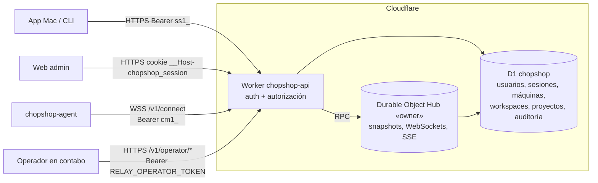

# Backend de Chopshop (`chopshop-api`, Cloudflare)

El backend con cuentas sustituye al relay de tokens `cr1_`. Es un Cloudflare Worker (`apps/backend`, nombre de despliegue
`chopshop-api`) con una base D1 (`chopshop`) como fuente de verdad y un único Durable Object `Hub` para lo que está en vivo.
Cuentas solo por invitación: un **dueño** (posee máquinas, workspaces y su ciudad; edita todo) y **watchers** (solo lectura de
los workspaces que el dueño les comparte). Cada `chopshop-agent` ligado a la cuenta **sale** hacia el backend por WebSocket,
publica sus snapshots y eventos y recibe la estructura de sus proyectos; la app Mac y la web entran con correo y contraseña.

Este documento cubre la operación: dominios, secretos, despliegue, migraciones, bootstrap, enlace de máquinas, recuperación y
verificación. La API está en [`backend-api.md`](backend-api.md) y el protocolo del agente en
[`relay-protocol.md`](relay-protocol.md). Diseño completo: `docs/plans/auth-backend.md`. Si algo de aquí no coincide con los
schemas de `packages/api/backend/` o con `apps/backend/src/`, mandan esos.

## Arquitectura



| pieza | archivo | qué hace |
|---|---|---|
| Worker | `apps/backend/src/index.ts`, `router.ts` | Despacha por `Host` (web → assets, API → rutas), resuelve el principal, autoriza y llama a los handlers. |
| HTTP | `src/http.ts` | Errores, CORS, CSRF, cookie, cabeceras de seguridad, límite de cuerpo (1 MiB). |
| identidad | `src/auth.ts`, `src/crypto.ts`, `src/ratelimit.ts`, `src/routes/{auth,sessions,invitations,users,operator,recovery}.ts` | Sesiones, contraseñas con pepper, límites de intentos, invitaciones, operador y recuperación. |
| máquinas | `src/machines.ts`, `src/routes/machines.ts` | Enlace por login, token para VPS, pausa, revocación, `verifyMachine`. |
| estructura | `src/access.ts`, `src/structure.ts`, `src/routes/{workspaces,projects}.ts` | Workspaces (campus), compartición, proyectos, layouts, roles, `structure_rev` y documento `sync`. |
| en vivo | `src/hub.ts`, `src/agentws.ts`, `src/viewer.ts`, `src/state.ts`, `src/routes/live.ts` | Hub único (`idFromName("owner")`) con WebSockets de agentes (Hibernation), snapshots por `(máquina, workspace)`, SSE filtrado por workspace y `GET /v1/state`. |
| auditoría | `src/audit.ts` | `audit_log` en D1. |
| migraciones | `apps/backend/migrations/0001_identity.sql`, `0002_machines.sql`, `0003_structure.sql` | Esquema de D1. |
| web admin | `apps/web-admin` → `apps/web-admin/dist` | Aceptar invitación y login, servida con Workers Assets. |

Lado del agente (Python, solo stdlib):

| pieza | archivo | qué hace |
|---|---|---|
| `chopshop relay link\|status\|unlink\|import --dry-run` | `apps/agent/chopshop/relaycfg.py` | Guarda la credencial en `~/.config/chopshop/relay/machine.json` (0600, directorio 0700; respeta `XDG_CONFIG_HOME`) y nunca la imprime entera (`cm1_…abcd`). |
| `chopshop relay admin bootstrap\|recover` | `apps/agent/chopshop/relayadmin.py` | CLI del operador: llama `/v1/operator/*`, imprime el enlace una vez y nunca el secret. |
| hilo `relay` | `apps/agent/chopshop/agent/relay.py`, `relaysync.py`, `cloudsync.py` | Conecta con la `cm1_`, manda snapshots por workspace y eventos, aplica `sync` (modo nube). |
| endpoint local de enlace | `apps/agent/chopshop/agent/server.py` | `GET /local/relay/status`, `POST /local/relay/link|unlink` solo en loopback y con nonce: la app Mac entrega la credencial sin que nadie la vea. |

## Dominios

| host | qué | cómo |
|---|---|---|
| `api.chopshop.novarix.online` | la API (HTTP, SSE y WebSocket `/v1/connect`) | Custom Domain del Worker |
| `chopshop.novarix.online` | la web admin estática | el mismo Worker con Workers Assets |

`apps/backend/wrangler.toml` declara los dos como `custom_domain = true` en `routes` y `workers_dev = false` (no hay URL
`*.workers.dev`). Cloudflare crea los registros DNS y el certificado al desplegar; la zona `novarix.online` tiene que estar en la
misma cuenta. Cualquier otro `Host` responde `404`. Las URLs base van en `[vars]`: `API_ORIGIN` y `WEB_ORIGIN`.

## Secretos y permisos

| secreto | dónde vive | para qué |
|---|---|---|
| `CLOUDFLARE_API_TOKEN` | secret del repositorio | despliegue y migraciones desde Actions |
| `CLOUDFLARE_ACCOUNT_ID` | secret del repositorio | cuenta de Cloudflare |
| `RELAY_OPERATOR_TOKEN` | secret del repositorio → secret del Worker en cada deploy; copia del operador en un archivo 0600 | `POST /v1/operator/bootstrap` y `/recover` (mismo valor que el relay v1) |
| `PASSWORD_PEPPER` | **solo** secret del Worker; nunca en el repo, en Actions, en D1 ni en `[vars]` | pepper HMAC de las contraseñas |
| `PASSWORD_PEPPER_V<n>` | secret del Worker, solo durante una rotación | valor anterior del pepper |

Permisos de `CLOUDFLARE_API_TOKEN` (un token con permisos acotados, nunca la Global API Key):

| ámbito | permiso |
|---|---|
| Cuenta | Workers Scripts: Edit · D1: Edit · Account Settings: Read |
| Zona `novarix.online` | Zone: Read · DNS: Edit · Workers Routes: Edit |

DNS: Edit hace falta porque los Custom Domains crean sus registros DNS y su certificado.

**Pepper.** El dueño lo fija **una vez**, a mano y antes del primer despliegue, desde su máquina con `wrangler` autenticado (el
valor no pasa por la pantalla ni por el historial):

```sh
openssl rand -base64 32 | wrangler secret put PASSWORD_PEPPER --name chopshop-api
```

Sin `PASSWORD_PEPPER` (≥ 32 caracteres) las rutas de contraseña responden `503`. La versión va en la var
`PASSWORD_PEPPER_VERSION` (por defecto `1` si falta). **Si se pierde el pepper**, ninguna contraseña verifica: se fija uno
nuevo y el dueño entra por la recuperación del operador; los watchers no tienen recuperación propia (ver
«Recuperación del dueño»). **Rotación**: se copia el
valor vigente a `PASSWORD_PEPPER_V<versión actual>`, se fija un `PASSWORD_PEPPER` nuevo y se sube `PASSWORD_PEPPER_VERSION`;
cada login correcto rehace el hash y, cuando ningún `users.password_hash` lleve ya `-p<versión vieja>`, se borra el secret viejo.

**Operador.** Crear o rotar el secret de operador (el valor no pasa por la pantalla):

```sh
umask 077; mkdir -p ~/.config/chopshop/relay
python3 -c 'import secrets; print(secrets.token_urlsafe(32))' > ~/.config/chopshop/relay/operator
gh secret set RELAY_OPERATOR_TOKEN < ~/.config/chopshop/relay/operator
```

La rotación surte efecto en el siguiente deploy. Tras el bootstrap el secret de operador solo sirve para `recover` (y para un
`bootstrap` que responde 409).

## Despliegue

Nada se despliega sin aprobación explícita del dueño (fase 1 de `docs/plans/auth-backend.md` §8.1), y **nunca** desde una
máquina de desarrollo: ni `wrangler deploy` ni `wrangler d1 migrations apply --remote` a mano (la única excepción es el
`wrangler secret put PASSWORD_PEPPER` de arriba, que hace el dueño).

Antes del primer despliegue, una vez:

1. Crear la D1: `wrangler d1 create chopshop` (lo hace el dueño) y poner su id en `database_id` de `apps/backend/wrangler.toml`
   (el workflow se niega a desplegar mientras quede el marcador `<id de la D1…>`).
2. Fijar `PASSWORD_PEPPER` (arriba) y comprobar que existen los secrets del repositorio.

Workflow `.github/workflows/backend-deploy.yml`, **solo manual** (`workflow_dispatch`, nunca por tag):

```sh
gh workflow run backend-deploy.yml --ref <rama o commit> -f confirm=DEPLOY
```

El job (Node 24, pnpm, `concurrency: backend-deploy` sin cancelar el que está en curso):

1. Exige `confirm = DEPLOY` y un `database_id` real.
2. `pnpm install --frozen-lockfile --filter @chopshop/backend... --filter @chopshop/web-admin...`; `check` y `test` del backend y
   de la web; `build` de la web (`apps/web-admin/dist`).
3. `wrangler d1 migrations apply chopshop --remote` (migraciones de `apps/backend/migrations`).
4. `wrangler deploy` con `RELAY_OPERATOR_TOKEN` subido como secret del Worker (sin imprimirlo).

Plan de la cuenta: **Workers Free**. `wrangler.toml` no lleva `[limits] cpu_ms` (solo existe en Paid); PBKDF2 está calibrado a
10 000 iteraciones para caber en 10 ms de CPU (ver [`backend-api.md`](backend-api.md#contraseñas-tokens-y-límites)).

Cron: `wrangler.toml` declara `17 4 * * *` para purgar sesiones caducadas, invitaciones viejas, intentos de login sin
actividad (`purgeAttempts`) y auditoría de más de 180 días; el Worker aún no exporta el handler `scheduled`, así que hoy esa
purga no corre.

Un deploy corta todos los WebSockets: los agentes reconectan solos con backoff y los visores reabren `/v1/stream` (cambia la
época del stream y reciben `resume: "snapshot"`). D1 y el SQLite del Hub sobreviven al deploy.

### Migraciones D1

- Numeradas en `apps/backend/migrations/NNNN_nombre.sql` (formato de `wrangler d1 migrations`). Una migración aplicada en
  producción **nunca** se edita: se añade otra.
- Reglas de portabilidad a Postgres: ids UUID en `TEXT`, fechas ISO-8601 en `TEXT` generadas por la aplicación, sin booleanos
  (fechas nullable o `TEXT` con `CHECK`), JSON en `TEXT`, sin `STRICT` ni funciones JSON de SQLite.
- Las aplica solo el workflow (paso 3). En local, los tests las aplican sobre un doble de D1 en `node:sqlite`
  (`pnpm --filter @chopshop/backend run test`).

Validación local, sin credenciales ni red hacia Cloudflare:

```sh
pnpm install --frozen-lockfile
pnpm --filter @chopshop/backend run check
pnpm --filter @chopshop/backend run test
python3 tools/contract_audit.py --backend
```

## Bootstrap del dueño (una sola vez)

No hay registro abierto: la primera cuenta la crea el operador.

1. En contabo, con el secret de operador en un archivo 0600:

   ```sh
   chopshop relay admin bootstrap --email <correo del dueño> --token-file ~/.config/chopshop/relay/operator
   ```

   (o `--stdin`; el secret nunca va en `argv`; `--api URL` cambia la base, por defecto `https://api.chopshop.novarix.online`).
   Llama `POST /v1/operator/bootstrap`: revoca invitaciones `owner_bootstrap` pendientes, crea una nueva (caduca en 24 h) e
   imprime **una vez** el enlace `https://chopshop.novarix.online/invite#t=ci1_…`. Salida: 0 ok, 1 error, 2 ya hay dueño (409).
2. El dueño abre el enlace en el navegador (o lo pega en la app Mac, «Aceptar invitación») y fija su contraseña (12 a 256
   caracteres). Se crean el usuario `owner`, el workspace `Personal` y una sesión, y se muestra el **código de recuperación**
   (`XXXXX-XXXXX-XXXXX-XXXXX`) **una sola vez**: guardarlo fuera de línea.
3. Desde ahí todo se gestiona en la app Mac (o la web): invitar watchers, compartir workspaces, ligar máquinas.

Errores: secret incorrecto `401` (5 fallos en 10 min por IP → bloqueo de 60 min); secret no configurado en el Worker `503`;
correo inválido `400`.

## Ligar máquinas

Nadie copia tokens a mano en la app de escritorio.

**Con la app Mac** (la propia Mac o la MacBook Air): con la sesión del dueño, «Máquinas → Ligar esta Mac». La app lee el
`machine_id` del agente local (`GET http://127.0.0.1:<puerto>/local/relay/status`), pide `POST /v1/machines/link` y entrega la
credencial al agente por loopback (`POST /local/relay/link` con el nonce de `~/.config/chopshop/agent/link.nonce`). El agente
la guarda 0600 y conecta sin reiniciar el servicio. Volver a ligar la misma máquina revoca la credencial anterior. Si la entrega
falla, la app revoca la máquina recién creada.

**VPS sin app** (p. ej. contabo): en la app, «Máquinas → Token para VPS» (`POST /v1/machines`) muestra **una vez** el JSON de
enlace. En el VPS:

```sh
umask 077
chopshop relay link --stdin    # pegar {"api_url", "machine_id", "local_machine_id", "credential"} y Ctrl-D
chopshop relay status          # API, WebSocket, máquina y credencial enmascarada; aviso si los permisos no son 0600/0700
```

`machine_id` es el id (UUID) de la máquina en la nube y `local_machine_id` el `[agent] machine_id` del VPS (o su hostname). El
primer `hello` fija `local_machine_id` en la nube; si otra máquina activa ya lo usa, la conexión se cierra con 4409 y la app
muestra el conflicto. Reiniciar el agente: `systemctl --user restart chopshop-agent` (Linux) o
`launchctl kickstart -k gui/$(id -u)/<label del agente>` (macOS).

**Desconectar y revocar** (app → Máquinas): «Desconectar» (`pause`) corta el WebSocket (4403) y rechaza reconexiones hasta
«Permitir» (`resume`); el agente reintenta cada 10 min. «Revocar» invalida la credencial para siempre (4401): el agente deja de
reintentar y queda desligado. `chopshop relay unlink` borra `machine.json` en la máquina, pero **no** revoca en la nube.

## Recuperación del dueño

1. **Con el código de recuperación** (sin operador): en la app o la web, «Usar código de recuperación» →
   `POST /v1/auth/recover {email, recovery_code, new_password}`. Fija la contraseña nueva, revoca **todas** las sesiones del
   dueño y devuelve un código nuevo (el anterior deja de valer). Límites: 5 fallos por IP y hora; 20 por correo y hora.
2. **Con el operador** (si también se perdió el código):

   ```sh
   chopshop relay admin recover --token-file ~/.config/chopshop/relay/operator
   ```

   Crea una invitación `owner_reset` para el correo del dueño (caduca en 1 h; revoca otras pendientes) e imprime el enlace una
   vez. Al aceptarla: contraseña nueva, todas las sesiones revocadas y código de recuperación nuevo. Salida 2 si no hay dueño.
3. Con sesión, el dueño puede regenerar el código en «Ajustes» (`POST /v1/auth/recovery-code`, pide la contraseña).

Un watcher que olvida su contraseña no tiene recuperación: `POST /v1/invitations` rechaza un correo que ya tiene usuario (409),
así que hoy el dueño solo puede desactivarlo; restablecer la contraseña de un watcher queda para después.

## Verificación tras el despliegue

La hace el dueño o el operador, no un hilo de implementación:

```sh
dig +short api.chopshop.novarix.online           # direcciones de Cloudflare
dig +short chopshop.novarix.online
curl -sS https://api.chopshop.novarix.online/health                 # {"ok":true,"version":"…"}
curl -sSI https://api.chopshop.novarix.online/v1/auth/me            # 401 con Cache-Control: no-store, HSTS, nosniff,
                                                                    # Referrer-Policy y X-Frame-Options
curl -sSI https://chopshop.novarix.online/                          # 200 con Content-Security-Policy
wrangler d1 migrations list chopshop --remote                       # sin migraciones pendientes
```

Y en la app: login del dueño, «Ligar esta Mac», la máquina aparece `online` y su campus en la ciudad.

## Límites

| qué | valor | dónde |
|---|---|---|
| plan | Workers Free: 10 ms de CPU por petición HTTP, 100 000 peticiones/día; D1 5 M filas leídas y 100 000 escritas al día | `docs/plans/auth-backend.md` §12 |
| Durable Objects | uno solo (`owner`) con Hibernation y SQLite | `hub.ts` |
| cuerpo HTTP | 1 MiB | `http.ts` |
| contraseña | 12–256 caracteres; PBKDF2 10 000 iteraciones con pepper | `crypto.ts` |
| sesiones | `mac`/`cli` 30 días de inactividad, 90 máx.; `web` 12 h, 7 días | `auth.ts` |
| invitaciones | watcher 1–720 h (168 por defecto); bootstrap 24 h; `owner_reset` 1 h | `routes/invitations.ts`, `routes/operator.ts` |
| intentos | ver la tabla de [`backend-api.md`](backend-api.md#contraseñas-tokens-y-límites) | `ratelimit.ts` |
| `hello` | ≤ 10 s tras el upgrade; ≤ 256 proyectos, ≤ 64 roles | `agentws.ts` |
| frame WebSocket | 1 MiB, solo texto | `agentws.ts` |
| snapshot | 1 cada 5 s por `(conexión, workspace)`; TTL 30–900 s (120); hoy cada uno se escribe en el SQLite del Hub (objetivo del plan: ≤ 1 por minuto y par) | `agentws.ts` |
| eventos | 50 por segundo por conexión | `agentws.ts` |
| inactividad del agente | `ping` cada 30 s; 90 s sin tráfico → 4408 | `agentws.ts` |
| visores `/v1/stream` | máx. 64; latido 15 s; búfer de reanudación 512 frames o 5 min | `viewer.ts` |
| máquinas revocadas | se listan 30 días | `machines.ts` |

## Relay v1 (`chopshop-relay`, obsoleto)

El relay de tokens `cr1_` (`apps/relay`, Worker `chopshop-relay` en `workers.dev`, protocolo en
[`relay-protocol-v1.md`](relay-protocol-v1.md)) sigue desplegado y **sin cambios** durante las fases 0–2: el agente lo usa solo
si no tiene `machine.json`. No hay migración de datos: sus tokens, códigos y cuentas `ac-…` no pasan a D1; las máquinas se
vuelven a ligar por login.

- Deploy: solo GitHub Actions (`.github/workflows/relay-deploy.yml`), con un tag `relay-v*` o `gh workflow run relay-deploy.yml`.
- Pairing: el operador crea un código con `POST /v1/pair/codes` (token de operador) y se canjea con `POST /v1/pair`; el agente
  guarda el `cr1_` con `chopshop relay pair --stdin` y lo borra con `chopshop relay unpair`; revocar es
  `DELETE /v1/tokens/<token_id>`.
- Fase 2: la app deja de ofrecer «pegar token `cr1_`». Fase 3 (con aprobación del dueño): se borran el Worker, `apps/relay`,
  `relay-deploy.yml` y el camino `cr1_` del agente y de la app.
