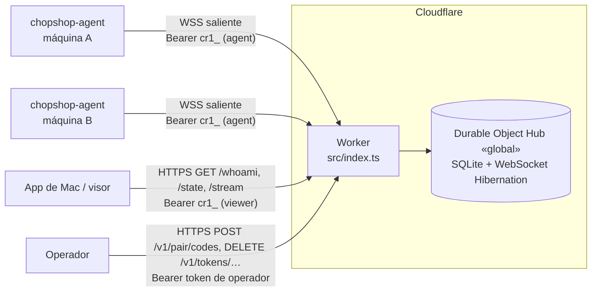

# Relay de Chopshop (Cloudflare Worker)

El relay deja ver el estado de varias máquinas desde fuera de la tailnet (p. ej. la app de Mac en un portátil) sin abrir
ningún agente a internet. Cada `chopshop-agent` **sale** hacia el relay por WebSocket y publica su snapshot y sus eventos; los
visores leen por HTTP. El relay es de **solo lectura**: no reenvía órdenes a los agentes, no habla con T3 y no interpreta las
partes opacas del snapshot. Lanzar, responder, asentar o encolar sigue siendo del MCP y de la API del agente en la tailnet.

Este documento cubre la arquitectura, los roles, el pairing, los tokens, el deploy y los límites. El formato de cada mensaje
(campos, lista blanca de lo que sale de la máquina, schemas) está en [`relay-protocol.md`](relay-protocol.md); si los dos no
coinciden, mandan los schemas de `packages/api/relay/` y el código de `packages/relay/src/`.

## Arquitectura



| pieza | archivo | qué hace |
|---|---|---|
| Worker | `packages/relay/src/index.ts` | Reenvía toda petición al único Durable Object (`HUB.idFromName("global")`). |
| `Hub` (Durable Object) | `src/index.ts` | Resuelve el rol del llamador, autoriza la ruta y la despacha. Su `alarm()` purga snapshots caducados y cierra conexiones de agente sin `hello` o inactivas. |
| rutas y roles | `src/routes.ts` | Tabla `ROUTES` (ruta, método, roles permitidos), `resolveCaller` y `authorize`. |
| pairing | `src/pair.ts` | Crear, canjear y revocar códigos; revocar tokens; rate limit de canje. |
| base de datos | `src/db.ts` | SQLite del Durable Object: `tokens`, `machines`, `snapshot`, `pair_codes`, `attempts` (migraciones versionadas en `schema_meta`). |
| agentes | `src/agentws.ts` | WebSocket del agente (`/agent/ws` = `/v1/connect`) con Hibernation: `hello`/`welcome`, `snapshot`, `event`, `ping`/`pong`, `whoami`. |
| visores | `src/viewer.ts` | `GET /state` (JSON) y `GET /stream` (SSE) por cuenta, con búfer en memoria para reanudar. |

Lado del agente (Python, solo stdlib):

| pieza | archivo | qué hace |
|---|---|---|
| CLI `chopshop relay pair\|status\|unpair` | `apps/agent/chopshop/relaycfg.py` | Guarda el token `cr1_` en `~/.config/chopshop/relay/token` (0600; respeta `XDG_CONFIG_HOME`) y nunca lo imprime (solo prefijo y últimos 4 caracteres). |
| hilo `relay` del servicio | `apps/agent/chopshop/agent/relay.py` | Si hay `[relay] url` y un token válido, conecta, manda `hello`, el snapshot (al conectar, si cambia —como mucho cada 6 s— y al menos cada `ttl/2`) y los eventos del bus (hasta 40 por segundo). Reconecta con backoff exponencial con jitter (tope 60 s). |
| serialización | `apps/agent/chopshop/relaysync.py` | Construye `hello`, `snapshot` y `event` aplicando la lista blanca de `relay-protocol.md`. |
| cliente WebSocket | `apps/agent/chopshop/wsclient.py` | RFC 6455 mínimo; solo `ws://` y `wss://`. |

Datos que guarda el relay: hashes SHA-256 de tokens y de códigos (con sal), el **último** snapshot de cada máquina durante su TTL,
la lista de máquinas vistas (`machine_id`, versión del agente, proyectos y roles) y los intentos fallidos de canje por IP (1 min).
Los eventos no se guardan: se reenvían a los visores conectados y se retienen solo en memoria para reanudar un `/stream`.

## Roles y rutas

El rol sale de la cabecera `Authorization` (`routes.ts`, `resolveCaller`):

| rol | credencial | para qué |
|---|---|---|
| `anonymous` | sin cabecera | solo canjear un código (`POST /v1/pair`) y `GET /health` |
| `viewer` | `Bearer cr1_…` de scope `viewer` | leer el estado de su cuenta; solo `GET` (cualquier otro método → 403) |
| `machine` | `Bearer cr1_…` de scope `agent` | abrir el WebSocket del agente atado a su `machine_id` |
| `admin` | `Bearer <RELAY_OPERATOR_TOKEN>` | crear códigos de pairing y revocar tokens o códigos, en cualquier cuenta |

Una cabecera mal formada o un token inválido o revocado → 401 antes de mirar la ruta.

| método y ruta | roles | respuesta |
|---|---|---|
| `GET /health` | todos (no mira la credencial) | `{ok: true, hub}` |
| `GET /whoami` | `viewer`, `machine` | `{role, machine_id}` (`machine_id: null` para un visor) |
| `GET /state` | `viewer` | `{v, type: "state", id, ts, head, machines[], snapshots[]}` de su cuenta |
| `GET /stream` | `viewer` | SSE: `hello`, luego `snapshot`/`event` en vivo (reanuda con `Last-Event-ID` o `?after=`) |
| `GET /v1/connect` (alias exacto de `GET /agent/ws`) | `machine` | upgrade a WebSocket (101) |
| `POST /v1/pair` | `anonymous` | canjea un código → `{token_id, token, scope, machine_id, protocol}` |
| `POST /v1/pair/codes` | `admin` | crea un código → `{id, code, scope, name, account, expires_at}` |
| `DELETE /v1/tokens/<token_id>` | `admin` | 204; cierra al instante los WebSockets y los `/stream` de ese token |
| `DELETE /v1/pair/codes/<id>` | `admin` | 204; invalida un código sin usar |

Un rol que no puede usar una ruta → 401 (anónimo) o 403; una ruta desconocida → 404; un método distinto en una ruta permitida → 405
con `Allow`. La matriz completa, incluidos los casos 404/405, está en `relay-protocol.md` («Rutas por rol»).

**Cuentas.** Cada token pertenece a una cuenta (`ac-` + 8 hex). Un visor solo ve las máquinas de su cuenta, así que el token del
agente y el del visor tienen que salir de códigos de la **misma** cuenta (ver «Pairing»).

## Tokens

| token | forma | dónde vive | caducidad |
|---|---|---|---|
| `cr1_` de scope `agent` | `cr1_` + 43 caracteres base64url (32 bytes aleatorios) | máquina: `~/.config/chopshop/relay/token` (0600) | no caduca; se revoca |
| `cr1_` de scope `viewer` | igual | app de Mac: Llavero (en desarrollo, un archivo local) | no caduca; se revoca |
| token de operador | cualquier cadena secreta | secret del Worker y secret del repositorio `RELAY_OPERATOR_TOKEN`; copia del operador en un archivo 0600 | hasta que se rote |

- El relay guarda solo `sha256(token)` y devuelve el token **una sola vez**, en la respuesta del canje. `last_seen_at` se
  actualiza como mucho una vez por minuto.
- Un token `agent` queda atado al `machine_id` con el que se canjeó: un `hello` con otro `machine_id` → `forbidden` y cierre.
  Volver a emparejar el mismo `machine_id` en la misma cuenta emite un token nuevo y **revoca el anterior**.
- Los tokens `cr1_` (relay) y `cs1_` (dispositivo de la API del agente, `docs/agent-api.md`) son credenciales distintas: una no
  sirve en el otro sitio.
- El token de operador se compara por SHA-256 en tiempo constante. Si el Worker no tiene el secret, no existe el rol `admin`:
  nadie puede crear códigos ni revocar.

## Pairing

Los comandos usan `RELAY` como la URL base del Worker (`https://chopshop-relay.<subdominio>.workers.dev`, por
`workers_dev = true` en `packages/relay/wrangler.toml`) y la copia local del token de operador en
`~/.config/chopshop/relay/operator` (0600). Ningún paso imprime un token `cr1_` ni el de operador.

### 0. Elegir la cuenta

Sin `?account=`, cada código abre una cuenta nueva. La respuesta trae su `account` desde el arreglo de BUG-1
(`docs/plans/issue-2-checklist.md`), que llega con el primer deploy posterior a `relay-v0.1.0`; ese tag aún no lo devuelve. Lo
más simple es elegir una vez un id y pasarlo siempre (un id nuevo crea la cuenta):

```sh
python3 -c 'import secrets; print("ac-" + secrets.token_hex(4))'   # p. ej. ac-1a2b3c4d; guárdalo junto al token de operador
ACCOUNT=ac-1a2b3c4d
```

### 1. Crear un código (operador)

```sh
curl -fsS -X POST "$RELAY/v1/pair/codes?account=$ACCOUNT" \
  -H "Authorization: Bearer $(cat ~/.config/chopshop/relay/operator)" \
  -H 'Content-Type: application/json' \
  -d '{"scope": "agent", "name": "host-b", "ttl_s": 600}'
# → {"id": "rc-…", "code": "K7QM-93XD", "scope": "agent", "name": "host-b", "account": "ac-1a2b3c4d", "expires_at": "…"}
```

`scope` es `agent` (una máquina) o `viewer` (la app). `ttl_s` va de 1 a 3600 (600 por defecto). El código se muestra una sola
vez; `DELETE /v1/pair/codes/<id>` lo invalida si no se llegó a usar.

### 2a. Emparejar una máquina (agente, también headless)

En la máquina, con el `machine_id` de su `[agent] machine_id` (vacío = nombre de host):

```sh
umask 077
curl -fsS -X POST "$RELAY/v1/pair" -H 'Content-Type: application/json' \
  -d '{"code": "K7QM-93XD", "machine_id": "host-b", "client_name": "host-b"}' -o relay-pair.json
python3 -c 'import json; d = json.load(open("relay-pair.json")); print(d["token_id"], d["scope"], d["machine_id"])'
python3 -c 'import json; print(json.load(open("relay-pair.json"))["token"])' | chopshop relay pair --stdin
rm relay-pair.json
```

Apunta el `token_id` (`tk-…`): es lo que se usa para revocar. Luego, en `~/.config/chopshop/config.toml`:

```toml
[relay]
url = "wss://chopshop-relay.<subdominio>.workers.dev/v1/connect"
```

(o `CHOPSHOP_RELAY__URL`) y reinicia el agente: `systemctl --user restart chopshop-agent` en Linux, o
`launchctl kickstart -k gui/$(id -u)/<label del agente>` en macOS. Comprobación:

```sh
chopshop relay status                        # URL y token enmascarado; sale con 1 si falta algo
journalctl --user -u chopshop-agent -n 50    # Linux: «relay conectado (sesión ss-…)»
```

`chopshop relay pair --token-file F` es la alternativa a `--stdin` (avisa si `F` es legible por otros). `chopshop relay unpair`
borra el token local, pero **no** lo revoca en el relay.

### 2b. Emparejar la app (visor)

Crea un código `viewer` de la misma cuenta y canjéalo sin `machine_id`:

```sh
umask 077
curl -fsS -X POST "$RELAY/v1/pair" -H 'Content-Type: application/json' \
  -d '{"code": "<código viewer>", "client_name": "app-mac"}' -o relay-viewer.json
```

La app de Mac todavía no canjea códigos: en su pantalla de conexión al relay se pega la URL base (`https://…`) y el `token` de
ese JSON, que la app guarda en el Llavero. Borra el archivo después. La app valida con `GET /whoami` y lee `GET /state`.

### 3. Revocar

```sh
curl -fsS -X DELETE "$RELAY/v1/tokens/tk-0a1b2c3d" -H "Authorization: Bearer $(cat ~/.config/chopshop/relay/operator)"
```

Efecto inmediato: el WebSocket del agente recibe `error unauthorized` con `close: true` y se cierra con 4401; un `/stream` del
visor recibe un `event: error` y se corta. No hay listado de tokens: guarda los `token_id` al emparejar.

### Fallos del canje

| caso | respuesta |
|---|---|
| código inválido | 401 `unauthorized` |
| código usado, caducado o invalidado | 410 `gone` |
| código `agent` sin `machine_id`, campos desconocidos, cuerpo no JSON | 400 `bad_request` |
| 5 fallos en un minuto desde la misma IP | 429 `rate_limited` con `Retry-After` |
| cada fallo (de cualquier IP) | suma 1 a todos los códigos vivos, de todas las cuentas; un código con 20 se invalida |

El código se normaliza (sin guiones ni espacios, mayúsculas, `O→0`, `I/L→1`) y se compara por hash con sal en tiempo constante.

## Deploy

El Worker se despliega **solo** desde GitHub Actions (`.github/workflows/relay-deploy.yml`); nunca con `wrangler deploy` ni
`wrangler secret put` desde una máquina.

| disparador | cómo |
|---|---|
| tag `relay-v*` | `git tag relay-v0.2.0 && git push origin relay-v0.2.0` |
| manual | `gh workflow run relay-deploy.yml --ref <rama o tag>` (`workflow_dispatch`) |

El job (Node 24, pnpm, `concurrency: relay-deploy` sin cancelar el que está en curso) hace:

1. `pnpm install --frozen-lockfile --filter @chopshop/relay...` y `pnpm --filter @chopshop/relay run check` (`tsc --noEmit`).
2. `cloudflare/wrangler-action` con `command: deploy` en `packages/relay`, con `apiToken` = secret `CLOUDFLARE_API_TOKEN`,
   `accountId` = secret `CLOUDFLARE_ACCOUNT_ID` y `secrets: RELAY_OPERATOR_TOKEN`: el valor sale del secret del repositorio del
   mismo nombre (expuesto como variable de entorno del paso) y se sube como secret del Worker en **cada** deploy, sin imprimirlo.

Secrets del repositorio que necesita: `CLOUDFLARE_API_TOKEN`, `CLOUDFLARE_ACCOUNT_ID` y `RELAY_OPERATOR_TOKEN`. Crear o rotar el
token de operador (el valor no pasa por la pantalla):

```sh
umask 077; mkdir -p ~/.config/chopshop/relay
python3 -c 'import secrets; print(secrets.token_urlsafe(32))' > ~/.config/chopshop/relay/operator
gh secret set RELAY_OPERATOR_TOKEN < ~/.config/chopshop/relay/operator
```

Una rotación surte efecto en el siguiente deploy (tag o `workflow_dispatch`); los tokens `cr1_` ya emitidos siguen valiendo.
Un deploy desconecta todos los WebSockets: los agentes reconectan solos con backoff y los visores reabren `/stream` (o siguen
leyendo `/state`). La base de datos del Durable Object sobrevive al deploy; el búfer de eventos en memoria no (cambia la época
del stream y el visor recibe `resume: "snapshot"`).

Validación local sin credenciales (no despliega nada; borra `node_modules` y `dist` al terminar):

```sh
pnpm install --filter @chopshop/relay...
pnpm --filter @chopshop/relay run check
pnpm --filter @chopshop/relay run deploy:dry     # wrangler deploy --dry-run --outdir dist
```

Salud del relay desplegado: `curl -fsS "$RELAY/health"`.

## Límites

| qué | valor | dónde |
|---|---|---|
| Durable Objects | uno solo (`global`) para todas las cuentas | `index.ts` |
| código de pairing | 8 símbolos Crockford (40 bits); TTL 600 s por defecto, máx. 3600 s | `pair.ts` |
| cuerpo de pairing | máx. 4096 bytes; `name`/`client_name` ≤ 128 caracteres; `machine_id` `[A-Za-z0-9_.:-]{1,128}` | `pair.ts` |
| canje | 5 fallos por IP y minuto → 429; 20 fallos → códigos vivos invalidados; códigos cerrados se borran a los 7 días | `pair.ts` |
| `hello` | debe llegar en ≤ 10 s tras el upgrade; ≤ 256 proyectos, ≤ 64 roles por proyecto | `agentws.ts` |
| frame del WebSocket | máx. 1 MiB, solo texto | `agentws.ts` |
| snapshot | 1 cada 5 s por conexión; TTL 30–900 s (120 por defecto); solo el último por máquina | `agentws.ts`, `db.ts` |
| eventos | 50 por segundo por conexión | `agentws.ts` |
| inactividad del agente | `ping` cada 30 s; 90 s sin tráfico → cierre 4408 | `agentws.ts` |
| conexiones por máquina | una: la nueva cierra la vieja con `conflict` | `agentws.ts` |
| visores `/stream` | máx. 64 a la vez (429 con `Retry-After: 3`); latido cada 15 s; `retry: 3000`; un visor con 256 escrituras pendientes se corta | `viewer.ts` |
| búfer de reanudación | 512 frames o 5 min, en memoria | `viewer.ts` |
| partes del snapshot (agente) | cada parte ≤ 768 KiB; parte `events` ≤ 80; cola ≤ 100 tareas por empleado | `relaysync.py` |

Lo que el relay **no** hace: no acepta escrituras de los visores, no manda órdenes a los agentes, no emite webhooks, no guarda
historial de eventos y no sirve el MCP (sigue en `chopshop mcp serve`, ver README). `GET /state` no distingue una máquina
desconectada de una con el snapshot caducado (BUG-10 de `docs/plans/contract-audit.md`).
