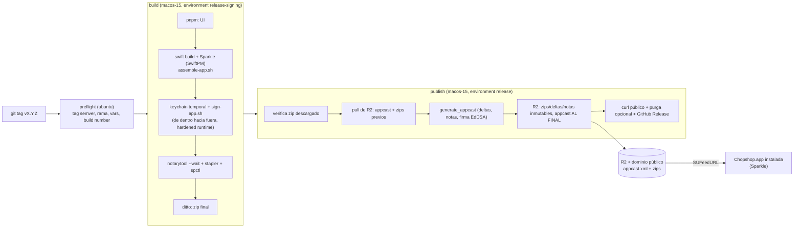

# Release de Chopshop.app (Sparkle, Developer ID, notarización y R2)

Pipeline de GitHub Actions que construye `Chopshop.app`, la firma con **Developer ID Application**, la **notariza**, la publica como zip en **Cloudflare R2** y actualiza el **appcast** de **Sparkle** para que las apps instaladas se actualicen solas (con deltas). Nada de nombres, dominios, Team IDs ni buckets está en el repo: todo sale de *secrets* y *variables* de GitHub (lista exacta más abajo). Todos los valores de esta guía son **falsos**.

> No se ejecuta nada al leer esto: los workflows solo corren al empujar un tag `vX.Y.Z` o al lanzarlos a mano. El dry-run no necesita credenciales.

## Arquitectura



| Pieza | Dónde | Qué hace |
|---|---|---|
| `.github/workflows/release-mac.yml` | tag `v*` / manual | `preflight` → `build` → `publish`. Manual = dry-run por defecto. |
| `.github/workflows/rollback-mac.yml` | manual | Retira una versión del feed sin tocar las demás. |
| `.github/workflows/release-tooling.yml` | PRs que tocan el pipeline | Tests, `shellcheck` y `actionlint` sin credenciales. |
| `apps/mac/release/*.sh` | scripts | `version`, `preflight`, `keychain`, `assemble-app`, `embed-sparkle`, `sign-app`, `notarize`, `package`, `sparkle-tools`, `notes`, `appcast`, `r2`, `publish`, `rollback`. |
| `apps/mac/release/appcast.py`, `notes.py` | Python (stdlib) | Validación del appcast (monotonía, firmas Ed25519), notas HTML. |
| `apps/mac/release/sparkle.version` | pin | Versión de Sparkle y SHA-256 del tarball; debe coincidir con `Package.swift`. |
| `apps/mac/Sources/ChopshopUI/Updater.swift` | app | `SPUStandardUpdaterController`, menú «Buscar actualizaciones…», canal beta. Desactivado sin `SUFeedURL`/`SUPublicEDKey`. |

Por qué dos *environments* con secretos: el job `build` solo ve lo necesario para firmar y notarizar (`release-signing`); el job `publish` solo ve la clave de Sparkle y R2 (`release`), y es ahí donde puedes exigir **aprobación manual**. El dry-run usa `release-dryrun`, un environment vacío y sin reglas: aunque lo lances desde una rama, no toca ningún secreto.

## Secrets y variables (lista exacta)

Los **secrets** van en el *environment* indicado (Settings → Environments → *nombre* → Environment secrets; un secret a nivel de repositorio también sirve, pero pierdes el aislamiento). Las **variables** van a nivel de **repositorio** (Settings → Secrets and variables → Actions → Variables) porque el job `preflight` también las lee. Para crear los environments basta ejecutar el workflow una vez: GitHub los crea al vuelo; después añade ahí los secrets y las reglas.

### Secrets del environment `release-signing` (job `build`)

| Nombre | Tipo | Para qué | Cómo obtenerlo | Ejemplo falso |
|---|---|---|---|---|
| `MACOS_CERT_P12_BASE64` | secret | Certificado Developer ID Application con su clave privada (.p12) en base64 | [Certificado Developer ID](#1-certificado-developer-id-application-p12) | `MIIKsQIBAzCC…` (base64 largo) |
| `MACOS_CERT_PASSWORD` | secret | Contraseña con la que exportaste el .p12 | La eliges al exportar | `contraseña-de-ejemplo` |
| `MACOS_KEYCHAIN_PASSWORD` | secret, opcional | Contraseña del keychain temporal. Si falta, se genera una aleatoria por ejecución (recomendado) | Cualquier cadena larga, o nada | `k3ychain-ejemplo` |
| `MACOS_SIGN_IDENTITY` | secret, opcional | Hash SHA-1 de la identidad a usar si el .p12 trae varias Developer ID | `security find-identity -v -p codesigning` | `0123456789ABCDEF0123456789ABCDEF01234567` |
| `APPLE_API_KEY_P8_BASE64` | secret | Clave de la API de App Store Connect (.p8) en base64, para `notarytool` | [API key de notarización](#2-api-key-de-notarización-p8) | `LS0tLS1CRUdJTiBQUklWQVRFIEtFWS0tLS0t…` |
| `APPLE_API_KEY_ID` | secret | Key ID de esa API key | Misma pantalla de App Store Connect | `ABC123DEFG` |
| `APPLE_API_ISSUER` | secret | Issuer ID del equipo | Misma pantalla de App Store Connect | `00000000-0000-0000-0000-000000000000` |

### Secrets del environment `release` (job `publish`, rollback)

| Nombre | Tipo | Para qué | Cómo obtenerlo | Ejemplo falso |
|---|---|---|---|---|
| `SPARKLE_ED_PRIVATE_KEY` | secret | Clave privada EdDSA de Sparkle (firma zips, deltas y el feed). Solo viaja por stdin, nunca a disco ni a logs | [Claves de Sparkle](#3-claves-de-sparkle-eddsa) | `Zm9vYmFyLWNsYXZlLWRlLWVqZW1wbG8=` |
| `R2_ACCOUNT_ID` | secret | Account ID de Cloudflare (forma el endpoint S3 de R2) | [Bucket R2](#4-bucket-r2-token-s3-y-dominio-público) | `0123456789abcdef0123456789abcdef` |
| `R2_ACCESS_KEY_ID` | secret | Access Key ID del token S3 de R2 | idem | `a1b2c3d4e5f60718293a4b5c6d7e8f90` |
| `R2_SECRET_ACCESS_KEY` | secret | Secret Access Key del token S3 de R2 | idem | `0f1e2d3c…` (64 hex) |
| `CLOUDFLARE_API_TOKEN` | secret, opcional | Token de API con permiso *Cache Purge* para purgar el `appcast.xml` del caché de Cloudflare. Solo se usa si también hay `CLOUDFLARE_ZONE_ID` | Cloudflare → My Profile → API Tokens | `cf-token-de-ejemplo` |

### Variables de repositorio obligatorias (release real)

| Nombre | Tipo | Para qué | Cómo obtenerlo | Ejemplo falso |
|---|---|---|---|---|
| `BUNDLE_ID` | var | `CFBundleIdentifier`. Una release real se niega a salir con `com.example.*` | Lo eliges (DNS inverso) | `org.example.chopshop` |
| `SPARKLE_PUBLIC_ED_KEY` | var | Clave **pública** EdDSA → `SUPublicEDKey` del Info.plist. Vacía = el pipeline falla | Salida de `generate_keys` | `AbCdEfGhIjKlMnOpQrStUvWxYz0123456789ABCDEFg=` |
| `SPARKLE_FEED_URL` | var | URL pública del `appcast.xml` → `SUFeedURL` (https). **Debe ser exactamente** `UPDATES_BASE_URL` + `/appcast.xml`: `generate_appcast` nombra el feed según esta URL y el pipeline lo publica y verifica ahí | `<UPDATES_BASE_URL>/appcast.xml` | `https://updates.example.com/appcast.xml` |
| `UPDATES_BASE_URL` | var | URL pública base de R2 (dominio propio del bucket, https, sin barra final). Prefijo de las URLs de descarga | Dominio personalizado del bucket | `https://updates.example.com` |
| `R2_BUCKET` | var | Nombre del bucket de R2 | Al crearlo | `bucket-de-ejemplo` |

### Variables de repositorio opcionales

| Nombre | Valor por defecto | Para qué | Ejemplo falso |
|---|---|---|---|
| `MIN_MACOS_VERSION` | `13.0` | `LSMinimumSystemVersion` y `sparkle:minimumSystemVersion`. El build falla si el binario exige un macOS más nuevo (`platforms` de `Package.swift`) | `13.0` |
| `SPARKLE_AUTO_UPDATE` | `false` | `SUAutomaticallyUpdate`: instalar sin preguntar. El usuario puede cambiarlo en las preferencias de Sparkle | `false` |
| `SPARKLE_CHECK_INTERVAL` | `86400` | `SUScheduledCheckInterval` en segundos (mínimo 3600). Con `SUEnableAutomaticChecks` activo | `86400` |
| `MAX_DELTAS` | `3` | Deltas que se generan hacia cada versión nueva (`--maximum-deltas`) | `3` |
| `MAX_VERSIONS` | `5` | Versiones que se conservan en el feed (`--maximum-versions`); los zips **nunca** se borran | `5` |
| `DELTA_COMPRESSION` | `lzma` | `--delta-compression` (`lzma`, `lzfse`, `lz4`) | `lzma` |
| `PHASED_ROLLOUT_INTERVAL` | vacío (sin rollout gradual) | Segundos entre tandas del rollout gradual (`sparkle:phasedRolloutInterval`); solo canal estable | `86400` |
| `FULL_RELEASE_NOTES_URL` | vacío | Enlace a las notas completas (`--full-release-notes-url`) | `https://updates.example.com/notes/` |
| `R2_PREFIX` | vacío | Subruta dentro del bucket; **debe** coincidir con la ruta de `UPDATES_BASE_URL` | `mac` |
| `CLOUDFLARE_ZONE_ID` | vacío | Zona del dominio público, para la purga de caché (junto con `CLOUDFLARE_API_TOKEN`) | `0123456789abcdef0123456789abcdef` |
| `SPARKLE_SIGNING_PUBLIC_ED_KEY` | = `SPARKLE_PUBLIC_ED_KEY` | Pública de la clave que **firma** cuando difiere de la que lleva la app: solo en el release puente de una [rotación](#rotación-de-claves) | `AbCdEfGhIjKlMnOpQrStUvWxYz0123456789ABCDEFg=` |
| `RELEASE_BRANCH` | `main` | Rama a la que debe pertenecer el tag, y única desde la que se lanza el rollback | `main` |
| `XCODE_VERSION` | vacío (Xcode por defecto del runner) | Fuerza `/Applications/Xcode_<versión>.app` | `16.4` |
| `UNIVERSAL_BINARY` | `1` | `UNIVERSAL=1` en `build.sh`: arm64 + x86_64. `0` = solo arm64 | `1` |

## Puesta en marcha (una vez)

### 1. Certificado Developer ID Application (.p12)

Requiere una cuenta del Apple Developer Program (el *Account Holder* puede crear certificados Developer ID).

1. En tu Mac: **Acceso a Llaveros → Asistente de Certificados → Solicitar un certificado a una autoridad de certificación…**, «Guardada en disco». Se crea la clave privada en tu llavero.
2. <https://developer.apple.com/account/resources/certificates/add> → **Developer ID Application** → sube el `.certSigningRequest` → descarga el `.cer` y haz doble clic para instalarlo.
3. En Acceso a Llaveros (categoría *Mis certificados*), selecciona **Developer ID Application: Nombre Demo (ABCDE12345)** (con su clave privada) → clic derecho → **Exportar…** → formato `.p12` con una contraseña (`MACOS_CERT_PASSWORD`).
4. A base64 y al secret, sin dejar rastro en el historial del shell:
   ```sh
   base64 -i certificado.p12 | gh secret set MACOS_CERT_P12_BASE64 --env release-signing
   gh secret set MACOS_CERT_PASSWORD --env release-signing   # pega la contraseña cuando la pida
   rm -P certificado.p12                                     # y guarda una copia cifrada en tu gestor de contraseñas
   ```

### 2. API key de notarización (.p8)

1. <https://appstoreconnect.apple.com/access/integrations/api> → pestaña **Team Keys** → **Generar clave API** (acceso *Developer* basta para notarizar).
2. Descarga `AuthKey_<KEYID>.p8` (**solo se puede descargar una vez**). En esa misma página están el **Key ID** y el **Issuer ID**.
3. ```sh
   base64 -i AuthKey_ABC123DEFG.p8 | gh secret set APPLE_API_KEY_P8_BASE64 --env release-signing
   gh secret set APPLE_API_KEY_ID --env release-signing
   gh secret set APPLE_API_ISSUER --env release-signing
   ```

### 3. Claves de Sparkle (EdDSA)

Usa las herramientas **de la misma versión que fija el repo** (`apps/mac/release/sparkle.version`); descarga y verifica el tarball:

```sh
cd "$(mktemp -d)"
gh release download 2.10.1 -R sparkle-project/Sparkle -p 'Sparkle-2.10.1.tar.xz'
shasum -a 256 Sparkle-2.10.1.tar.xz      # debe coincidir con SPARKLE_SHA256 de sparkle.version
tar -xf Sparkle-2.10.1.tar.xz ./bin
./bin/generate_keys                      # crea el par en TU llavero (cuenta «ed25519») e imprime la clave PÚBLICA
./bin/generate_keys -p                   # vuelve a imprimir la pública cuando la necesites
./bin/generate_keys -x sparkle_private   # exporta la PRIVADA a un archivo (generate_keys -x)
gh secret set SPARKLE_ED_PRIVATE_KEY --env release < sparkle_private
rm -P sparkle_private
gh variable set SPARKLE_PUBLIC_ED_KEY --body 'AbCdEfGhIjKlMnOpQrStUvWxYz0123456789ABCDEFg='   # la pública que imprimió generate_keys
```

- La **pública** va en la variable `SPARKLE_PUBLIC_ED_KEY` y se inyecta en `SUPublicEDKey`; la **privada** solo existe como secret y se pasa a `generate_appcast`/`sign_update` por stdin (`--ed-key-file -`).
- Guarda **una copia de la privada en un gestor de contraseñas**. Si se pierde, las apps ya instaladas no podrán verificar actualizaciones nuevas (ver [rotación](#rotación-de-claves)).
- El pipeline comprueba que privada y pública son pareja antes de firmar (Ed25519 propio, independiente de las herramientas de Sparkle) y que la firma de cada zip verifica con la pública (`sign_update --verify` y un verificador propio).

### 4. Bucket R2, token S3 y dominio público

1. Cloudflare → **R2 Object Storage** → **Create bucket** (p. ej. `bucket-de-ejemplo`) → variable `R2_BUCKET`.
2. En el bucket → **Settings → Custom Domains → Connect Domain** → `updates.example.com` (un dominio de tu zona Cloudflare). Esa URL (`https://updates.example.com`) es `UPDATES_BASE_URL`, y `SPARKLE_FEED_URL` es `https://updates.example.com/appcast.xml`. No uses el subdominio `r2.dev` para producción (limitado y sin caché de Cloudflare). Si publicas bajo una subruta (`R2_PREFIX=mac`), la URL base debe incluirla (`https://updates.example.com/mac`).
3. R2 → **Manage R2 API Tokens → Create API token** → permiso **Object Read & Write** limitado a ese bucket. Cloudflare muestra **Access Key ID** y **Secret Access Key** *una sola vez* → `R2_ACCESS_KEY_ID` y `R2_SECRET_ACCESS_KEY`. El **Account ID** está en el panel de R2 → `R2_ACCOUNT_ID`.
4. (Opcional) purga de caché: crea un token de API con permiso **Zone → Cache Purge** sobre esa zona (`CLOUDFLARE_API_TOKEN`) y guarda el ID de zona en `CLOUDFLARE_ZONE_ID`. Sin ellos no pasa nada: el `appcast.xml` se publica con `Cache-Control: public, max-age=60`, y los zips/deltas con `public, max-age=31536000, immutable`.

### 5. GitHub

```sh
gh variable set BUNDLE_ID --body org.example.chopshop
gh variable set SPARKLE_FEED_URL --body https://updates.example.com/appcast.xml
gh variable set UPDATES_BASE_URL --body https://updates.example.com
gh variable set R2_BUCKET --body bucket-de-ejemplo
# secrets de R2 en el environment `release` (cada `gh secret set` pide el valor por stdin)
gh secret set R2_ACCOUNT_ID --env release
gh secret set R2_ACCESS_KEY_ID --env release
gh secret set R2_SECRET_ACCESS_KEY --env release
```

Recomendado: en **Settings → Environments** pon al environment `release` *Required reviewers* (aprobación manual antes de publicar) y restringe `release` y `release-signing` a *Deployment tags* `v*`. No pongas reglas de aprobación en `release-signing` ni en `release-dryrun`.

## Versionado

- `CFBundleShortVersionString` = el tag sin la `v`. Se valida semver estricto (`v1.2.3`, `v1.2.3-beta.1`); cualquier otra cosa hace fallar el workflow antes de compilar.
- `CFBundleVersion` (lo que **compara Sparkle**) = fecha y hora UTC del release, `AAAAMMDDHHmm` (p. ej. `202610281530`). Es monótono sin depender del repo ni del workflow (`github.run_number` se reinicia si se renombra o recrea el workflow). Además `publish` **se niega** a publicar un build que no sea estrictamente mayor que el máximo del appcast, y a re-publicar una versión existente con otro contenido; un reintento del mismo run (mismo zip) es idempotente.
- Canales: un tag con prerelease (`-beta.N`, `-rc.N`…) entra al feed con `sparkle:channel` = `beta` y se marca *prerelease* en GitHub. Solo lo reciben las apps con «Recibir versiones beta» activado en el menú (o que ya corren una beta). Las versiones estables no llevan canal y las ven todos. El rollout gradual (`PHASED_ROLLOUT_INTERVAL`) solo se aplica al canal estable.

## Procedimiento de release

1. **Dry-run** (recomendado la primera vez y tras cambiar el pipeline): *Actions → Release Mac → Run workflow* con `dry_run` marcado. Construye la UI, compila con Sparkle, ensambla y firma **ad-hoc**, valida el Info.plist y el orden de firma y deja el zip como artefacto 3 días. No notariza ni publica, y no usa secretos.
2. **Tag y push** desde la rama de releases (`RELEASE_BRANCH`):
   ```sh
   git tag -a v1.2.3 --cleanup=verbatim -m "## Novedades
   - Descripción de los cambios visibles para el usuario"
   git push origin v1.2.3
   ```
   Las notas salen, por este orden, del **mensaje del tag anotado**, de la sección `## [1.2.3]` de `CHANGELOG.md` (si existe) o de los asuntos de commit desde el tag anterior. Usa `--cleanup=verbatim`: por defecto `git tag -m` borra las líneas que empiezan por `#`.
3. El job `build` firma y notariza (hasta 30 min de espera de Apple); `publish` espera aprobación si la configuraste, publica y verifica. Al terminar, el resumen del job muestra la versión, el build y la URL del feed.
4. Una release real también se puede lanzar desde *Run workflow* eligiendo el **tag** como ref y desmarcando `dry_run`; desde una rama se niega.

Qué comprueba el pipeline por ti (cada punto aborta el release):

| Paso | Comprobación |
|---|---|
| Preflight | tag semver; tag alcanzable desde `RELEASE_BRANCH`; vars presentes y con formato válido (https, clave pública = 32 bytes, `BUNDLE_ID` no genérico); secrets presentes (solo nombres faltantes, nunca valores) |
| Ensamblado | `Info.plist` con bundle id, versiones, `LSMinimumSystemVersion`, `SUFeedURL`, `SUPublicEDKey`, `SURequireSignedFeed`; el binario enlaza `Sparkle.framework` y tiene el rpath; su `minos` ≤ `MIN_MACOS_VERSION`; versión de Sparkle = `sparkle.version` |
| Firma | código anidado de dentro hacia fuera (XPC, `Autoupdate`, `Updater.app`, Mach-O sueltos, framework, app); `--options runtime --timestamp`; entitlements mínimos; `codesign --verify --deep --strict`; hardened runtime y sello de tiempo presentes |
| Notarización | `notarytool submit --wait`; si no es `Accepted`, imprime `notarytool log` y falla; `stapler staple`/`validate`, `spctl --assess --type execute -vv`, `codesign --verify` |
| Empaquetado | zip final con `ditto -c -k --sequesterRsrc --keepParent` **después** de grapar; se reabre y se vuelve a verificar; SHA-256 |
| Publicación | checksum del artefacto; firma de Apple de nuevo; `check-key` (privada↔pública); build monótono; no pisar zips; `generate_appcast`; item nuevo correcto (versión, build, canal, sistema mínimo); firma EdDSA de zip y deltas verificada con la pública y con `sign_update --verify`; feed firmado; subida en orden seguro; descarga pública del feed y del zip idénticos a lo publicado |

### Orden de subida y caché

1. `*.zip` y `*.delta` (inmutables, `Cache-Control: public, max-age=31536000, immutable`). Si un objeto ya existe con otro tamaño, se aborta (no se pisa un release publicado).
2. `notes/<versión>.html` (`max-age=300`).
3. **Al final** `appcast.xml` (`public, max-age=60`): ningún cliente ve un feed que apunte a archivos que aún no están.
4. Verificación con `curl` contra `UPDATES_BASE_URL`: el feed servido coincide byte a byte con el publicado, el zip nuevo también, y todo lo que referencia el feed responde 200.
5. Purga de caché solo si están `CLOUDFLARE_API_TOKEN` y `CLOUDFLARE_ZONE_ID`.
6. GitHub Release con el zip y su `.sha256` (prerelease si es beta; borrador si lanzas el workflow a mano con `draft_release`).

### Zips anteriores, deltas y política de borrado

- **Nunca se borran zips anteriores** ni se usa `--delete`/`s3 rm`: `generate_appcast` los necesita para crear deltas hacia la versión nueva (`MAX_DELTAS`) y las apps antiguas los necesitan para actualizar. El feed conserva solo las últimas `MAX_VERSIONS`; el resto sigue en R2.
- La única excepción es el **rollback explícito**, que **mueve** (no borra) los archivos de esa versión a `retired/` en el mismo bucket.
- `publish` baja de R2 el `appcast.xml` y solo los archivos que referencia (para recuperar un feed perdido a partir de todos los zips existe `r2.sh pull <dir> --all`).
- Los deltas solo se generan hacia versiones del mismo canal/rama del feed; la primera release no tiene deltas.

## Rollback

*Actions → Rollback Mac → Run workflow*, lanzado **desde la rama de releases**: indica la versión (`1.2.3`, sin `v`). Por defecto es **dry-run**: regenera y valida el feed sin esa versión y no publica nada. Con `dry_run` desmarcado:

1. `generate_appcast` regenera el feed **sin** esa versión (las demás versiones y sus firmas se conservan; los deltas hacia/desde ella desaparecen) y el mismo script lo valida.
2. Se publica solo el `appcast.xml`.
3. Después se mueven el zip y los deltas de esa versión a `retired/` (`keep_files` lo omite).
4. Purga opcional de caché y verificación pública.

Comparte el grupo de concurrencia `mac-updates-feed` con la publicación: un release y un rollback nunca escriben el feed a la vez. Se niega a dejar el feed vacío.

**Limitación que debes conocer:** Sparkle solo avanza. Quien ya instaló la versión mala **no retrocede**; el rollback evita nuevas instalaciones/actualizaciones hacia ella. Para quienes ya la tienen, publica cuanto antes una versión corregida con número mayor (`v1.2.4`; su `CFBundleVersion` será mayor automáticamente). Para forzar una actualización importante, `generate_appcast` admite `--critical-update-version`.

Para **reponer** una versión retirada: mueve a mano los objetos desde `retired/` a la raíz y vuelve a publicar (o lanza un release nuevo).

## Concurrencia y permisos

- `concurrency` de `release-mac`: un solo run por ref (`release-mac-<ref>`) y `cancel-in-progress: false`. El job `publish` (y el rollback) comparten `mac-updates-feed`, también sin cancelar: dos releases no pisan el appcast. Nota: GitHub conserva a lo sumo **un run pendiente** por grupo; si encolas tres, el pendiente más antiguo se cancela. No es peligroso: un release más viejo que el publicado fallaría de todos modos por el build monótono.
- Permisos mínimos: `contents: read` en todo el workflow; `contents: write` solo en `publish` (crear la GitHub Release). `persist-credentials: false` en todos los checkouts.
- No hay disparadores `pull_request`/`pull_request_target` en los workflows de release ni rollback: los forks no ejecutan nada con secretos.
- Acciones de terceros fijadas por **SHA de commit** (el comentario indica la versión) y las herramientas descargadas (Sparkle, `actionlint`) verifican su SHA-256.
- Los logs de repositorios públicos son públicos: el nombre del certificado y el Team ID que imprimen `security`/`spctl` se registran con `::add-mask::`, y la clave del keychain, si es generada, también.

## Rotación de claves

| Credencial | Qué hacer |
|---|---|
| API key de notarización, token S3 de R2, `CLOUDFLARE_API_TOKEN` | Crear la nueva, actualizar el secret y revocar la vieja. Sin impacto en las apps instaladas. |
| Certificado Developer ID (caduca a los 5 años) | Crear uno nuevo **del mismo equipo** (mismo Team ID) y sustituir `MACOS_CERT_P12_BASE64`/`MACOS_CERT_PASSWORD`. Sparkle comprueba que la firma de código de la versión nueva coincida con la instalada; con el mismo Team ID no hay problema. Cambiar de equipo rompe esa comprobación: las apps instaladas tendrían que reinstalarse a mano. |
| **Clave EdDSA de Sparkle** | **Limitación de Sparkle:** cada app instalada solo conoce la `SUPublicEDKey` con la que se construyó y verifica con ella. Una actualización firmada solo con una clave nueva la rechazan las apps antiguas. Procedimiento recomendado (consulta la sección de rotación de claves de la documentación de Sparkle y pruébalo antes con una beta): ver abajo. Si pierdes la privada **sin** haber rotado antes, no hay recuperación: los usuarios deben descargar e instalar a mano una versión con la clave nueva. |

Procedimiento de rotación de la clave EdDSA (con el mismo certificado Developer ID):

1. Genera la clave nueva (`generate_keys --account nueva`, `-x`) y guarda la privada vieja.
2. **Release puente**: construye con `SPARKLE_PUBLIC_ED_KEY` = pública **nueva** (la app lleva la nueva) pero firma todavía con la **vieja**: deja `SPARKLE_ED_PRIVATE_KEY` = privada vieja y define `SPARKLE_SIGNING_PUBLIC_ED_KEY` = pública **vieja** (así la guarda «privada↔pública» comprueba contra la que realmente firma). Las apps antiguas lo aceptan; las que lo instalen ya conocen la nueva.
3. Espera a que la mayoría haya actualizado (el menú de Sparkle y tus métricas de descarga te lo dirán).
4. Cambia `SPARKLE_ED_PRIVATE_KEY` por la privada nueva y borra `SPARKLE_SIGNING_PUBLIC_ED_KEY`. Los siguientes releases se firman con la nueva; el feed también (`SURequireSignedFeed`), por lo que quien siga con una versión anterior al puente no podrá verificarlo y deberá reinstalar a mano.

## Pruebas locales (sin credenciales)

```sh
cd apps/mac && python3 -m unittest discover -s release/tests      # o: pnpm test desde la raíz
shellcheck -x -P SCRIPTDIR -s bash apps/mac/release/*.sh          # opcional
actionlint .github/workflows/*.yml                                # opcional
```

Los tests ejecutan los scripts reales con ejecutables falsos (`security`, `codesign`, `xcrun`, `aws`, `curl`, `generate_appcast`…) y comprueban el orden de las operaciones (firma de dentro hacia fuera, zips antes que el appcast, rollback), que no se imprima ningún secreto y que workflows y scripts no lleven dominios, Team IDs ni nombres propios.

En un Mac con Xcode puedes ensamblar y firmar ad-hoc sin credenciales:

```sh
export SHORT_VERSION=0.0.0-local BUILD_NUMBER=1 RELEASE_MODE=dryrun
bash apps/mac/release/assemble-app.sh && SIGN_IDENTITY=- bash apps/mac/release/sign-app.sh apps/mac/build/release/Chopshop.app
```

## Problemas frecuentes

| Síntoma | Causa y arreglo |
|---|---|
| `preflight` falla con «Faltan N valor(es)» | El resumen del job lista los nombres (sin valores). Defínelos (secrets en el environment correcto; variables a nivel de repositorio). |
| `el binario exige macOS 26.0 … MIN_MACOS_VERSION=13.0` | `platforms` de `Package.swift` es más nuevo que lo que prometes. Baja el deployment target o define `MIN_MACOS_VERSION` con el valor real. |
| Notarización `Invalid` | El log (impreso por el pipeline) dice qué binario falla: normalmente código anidado sin firmar, sin hardened runtime o sin sello de tiempo. `sign-app.sh` firma todo el código anidado; si añades binarios nuevos aparecerán en el log. |
| `el .p12 no contiene una identidad 'Developer ID Application'` | Exportaste el certificado sin su clave privada, o es de otro tipo (*Apple Development*). Reexporta desde *Mis certificados*. |
| `la clave privada … no corresponde a SPARKLE_PUBLIC_ED_KEY` | Secret y variable son de pares distintos. Compara `generate_keys -p` con la variable. |
| `no es mayor que el máximo publicado` | Hay un release más nuevo en el feed (o se encolaron dos). Etiqueta de nuevo. |
| `403` o `Access Denied` al hablar con R2 | Token sin permiso de escritura en ese bucket, o `R2_ACCOUNT_ID` incorrecto. El pipeline **no** lo interpreta como «primera publicación»: aborta sin tocar el feed. |
| El feed servido no coincide con el publicado | Dominio o `R2_PREFIX` mal configurados, o caché de Cloudflare: añade `CLOUDFLARE_API_TOKEN`/`CLOUDFLARE_ZONE_ID`. |
| La app no ofrece actualizaciones | Un build local no trae `SUFeedURL`/`SUPublicEDKey` (updater desactivado a propósito). En una release: `SUScheduledCheckInterval`, o «Buscar actualizaciones…» a mano; revisa que el item del feed tenga `minimumSystemVersion` ≤ tu macOS. |

## Pendiente conocido

- `apps/mac/Package.resolved` no está versionado (la dependencia está fijada con `exact:`). Para fijar también la revisión de git, ejecuta `swift package resolve` en un Mac y commitea `Package.resolved`.
